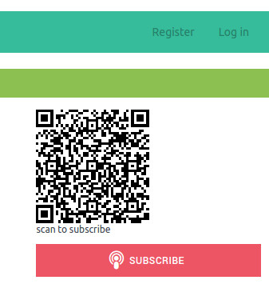
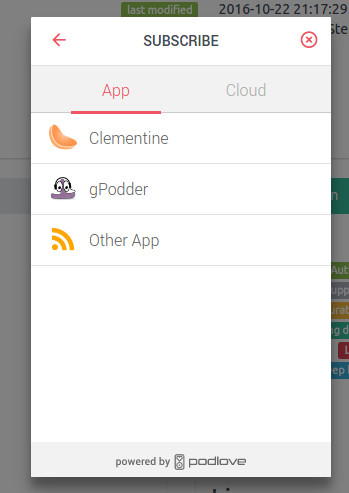
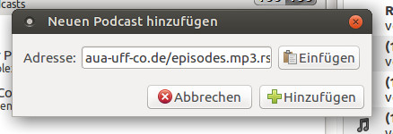

+++
title = "Feature: QR-Code"
date = 2016-11-13
authors = ["Sonja"]
redirect_from = ["/2016/11/13/QR-Code.html"]
+++

One of the great features is the subscription of a podcast via QR-code.

As a non iTunes user I often have problems to find the rss-feed to subscribe a podcast. The feed is often really good hidden on the homepage of the podcast. With the QR-code that Panoptikum shows for each podcast, I can subscribe with my smartphone in just a few steps:

* scan the code with the smartphone
* touch Abonnieren on the smartphone
* the next screen shows the logo, the title and a short description of the podcast
* touch Weiter and get a list of podcatcher apps
* select the one you use and the feed address is sent to your podcatcher app in the right way
* continue within your podcatcher

I really love that feature! No searching for the feed on unknown websites and no typing of the url (which often needs several attempts due to typos).
[Try it out](https://panoptikum.social) - this feature is up- and running! No registration required! The only limitation is the limited number (464) of podcasts available at the moment.

If you have your podcatcher on the computer (PC/laptop) just select Subscribe instead of scanning via Smartphone and a dialog opens that let's you select your programm on the computer and again the feed is sent to the podcatcher the correct way.

I selected gPodder and after a confirmation that Panoptium.io is allowed to open gPodder on my PC, the feed is inserted:

[Try it out](https://panoptikum.social)
