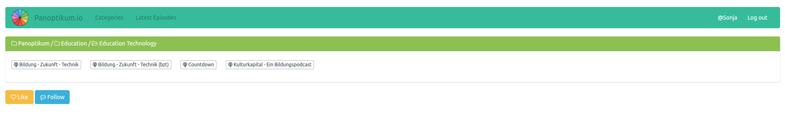
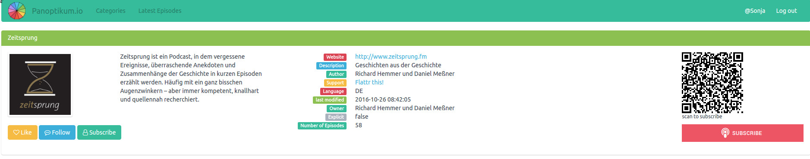
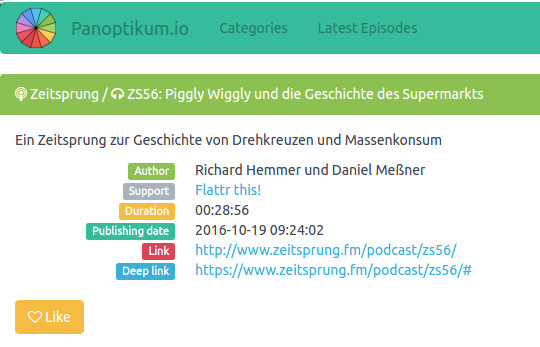

+++
title = "I like it"
date = 2016-11-20
authors = ["Sonja"]
redirect_from = ["/2016/11/20/alpha-updates2.html"]
+++

Panoptikum now offers its first social network functionalities.

Podcasts, Categories und Episodes can be liked. Categories and Podcasts can be followed. These are the manual basics, before the automatic recommendation algorithm. After your login you see additional buttons.

At the category level

* Like / Unlike - Tell other users that you like a podcast.
* Follow / Unfollow - Tell the system that you want to see other users actions regarding the podcast

At the podcast level

* Like / Unlike - Tell other users that you like a podcast.
* Follow / Unfollow - Tell the system that you want to see other users actions regarding the podcast
* Subscribe / Unsubscribe - Tell other users that you have subscribed this podcast

At the episode level

* Like / Unlike - Tell other users that you like a podcast.

Another great new feature ist the full text search. Amazing (for me as user) it works and is really fast.

[Try it out](https://panoptikum.social)
