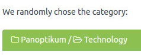
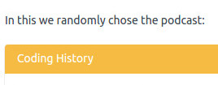
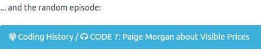
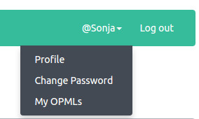

+++
title = "Random"
date = 2016-12-04
authors = ["Sonja"]
redirect_from = ["/2016/12/04/optimist.html"]
+++

Discover podcasts outside your personal bubble!

The new function Random presents a random choice. It presents a random category, a random podcast within this category and a random episode of that podcast.

With each refresh a new random selection is presented.

[Try it out](https://panoptikum.social/random)

---

The [start page](https://panoptikum.social/) now shows:
* Categories
  * duplicates are removed
* Search: the full text search
  * includes pagination
  * shows no duplicates
  * displays all hits
  * and the number of search results
* Top 10 Podcasts
* Latest Podcasts
* Latest Episodes

---

Last week I presented ways to try some of the new functionalities for real. Have you tried it out? This week further possibilties were added. After the login you can choose between

[Register Now](https://panoptikum.social/users/new) or [Login](https://panoptikum.social/sessions/new) with the [password recovery function](https://panoptikum.social/forgot_password), if you have already submitted your OPML-file to the project.
