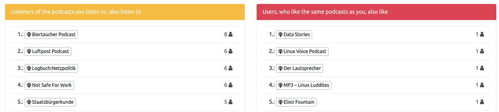
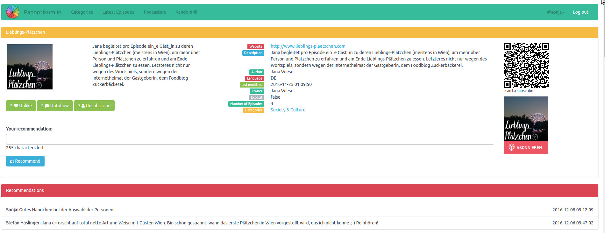

+++
title = "Automatic Proposals"
date = 2016-12-11
authors = ["Sonja"]
redirect_from = ["/2016/12/11/recommendation.html"]
+++

Login to see proposals based on subscribed podcasts and likes.

At last one of the core features (in my humble opinion) arrived.
Panoptikum shows two brand new lists:

* Listeners of the podcasts you listen to, also listen to
* Users, who like the same podcasts as you, also like

You find these lists after your login under My Podcasts.

For those who want good old personal recommendations, is it possible to write recommendations for each podcast you have subscribed. You find this function (after the login) under *My Recommendations* or directly on the page of each individual podcast. Tell other users in your own words why they should listen to this podcast! All recommendations per podcast are show on the podcast page.

[Register Now](https://panoptikum.social/users/new) or [Login](https://panoptikum.social/sessions/new) with the [password recovery function](https://panoptikum.social/forgot_password), if you have already submitted your OPML-file to the project.

Last but not least let me present the Panoptikum community manager in the Panoptikum Hoodie:

:::: columns
::: column
:::

::: image
image = "hoodiefront.jpg"
alt = "hoodiefront"
:::

::: column
:::

::: image
image = "hoodieside.jpg"
alt = "hoodieside"
:::
::::
