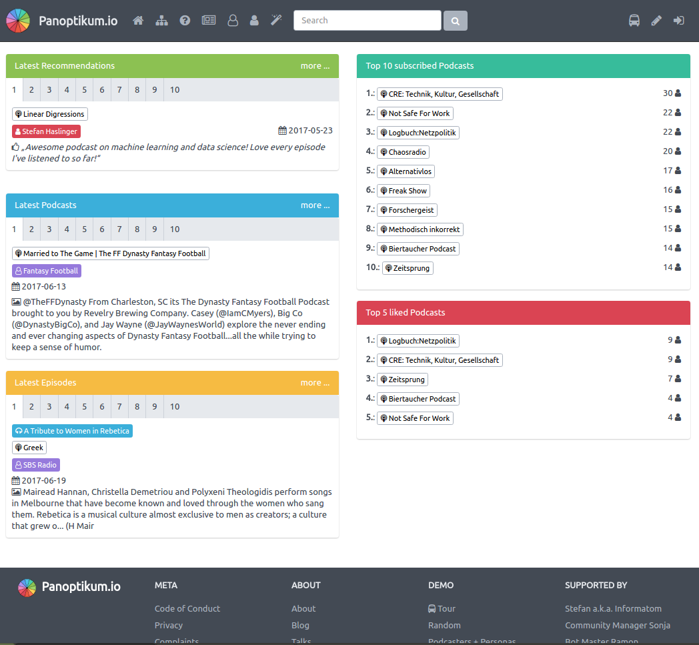
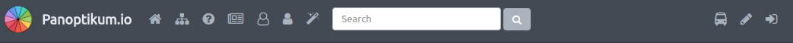

+++
title = "Start Page"
date = 2017-06-19
authors = ["Sonja"]
redirect_from = ["/2017/06/19/start_page.html"]
+++

We proudly present the new [start page](https://panoptikum.social/)!

While the Panoptikum offer did grow over the last (almost) year, the start page got a little overboarded. We received the feedback that it got overwhelming. After internal struggle, cause we were so proud to present the categories, the latest recommendations, the latest podcasts, the latest episodes and the top 10, Stefan rebuildt it.

You can now find the categories at their [own page](https://panoptikum.social/categories) and the search function is now available in the top center of each page.

The new header gives you direct access to
* [Home](https://panoptikum.social/)
* [Categories](https://panoptikum.social/categories)
* [About](/)
* [Blog](/blog)
* [Podcasters](https://panoptikum.social/personas)
* [Users](https://panoptikum.social/users)
* [Random](https://panoptikum.social/recommendations/random)
* Search
* [Tour](https://panoptikum.social/#)
* [Register](https://panoptikum.social/users/new)
* [Login](https://panoptikum.social/sessions/new)

Please send us your feedback! As you can see we listen to you and try to improve Panoptikum, based on your feedback!

<sonja@panoptikum.social>
