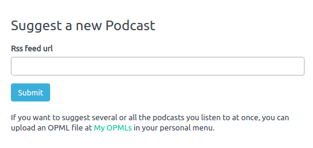
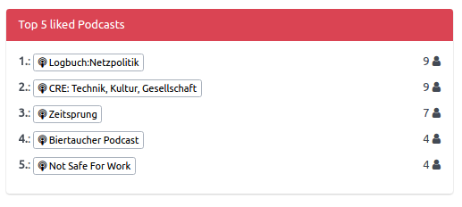

+++
title = "Suggest a Podcast"
date = 2017-06-26
authors = ["Sonja"]
redirect_from = ["/2017/06/26/add-single-feed.html"]
+++

It is now possible to add single feeds to Panoptikum with [Suggest a podcast](https://panoptikum.social/pan/feed_backlogs/new)!

After the Login you find under your user name the menu entry "Suggest a Podcast". With this function you can add a single feed directly to Panoptikum without the need to export an OPML-file from your podcatcher. We still recommend to use the OPML upload function for several podcasts, but this offers a quick and easy way for a single feed.

Other improvements of the last weeks:

* my personal favourite [Random Recommendation](https://panoptikum.social/recommendations/random) is now faster

* New widget on start page: Top 5 liked podcasts

A lot of work was the merging of Personas. Thousands duplicates were merged based on
* the same name, if referenced in same podcast or episode
* the same email address, if only name notation differs

This should now give a better overview: [Personas](https://panoptikum.social/personas).
