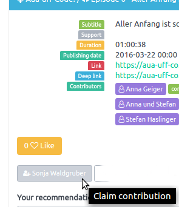
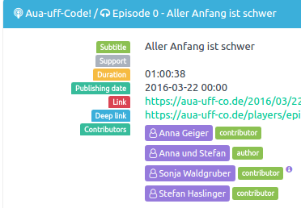
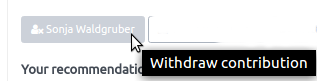

+++
title = "Add personal contribution"
date = 2017-07-10
authors = ["Sonja"]
redirect_from = ["/2017/07/10/add-personal-contribution.html"]
+++

Have you contributed to podcast episodes, but you are not listed as a contributor?

Not all podcasters are technical experts and sometimes things go wrong with all the details of a podcast episode. Between episode title, subtitle, author, puplishing date, description, summary and show notes a contribution to a single episode is often forgotten.

Panoptikum gives these forgotten contributors a way to mark episodes:
* Login
* Find the episode with your (unknown) contribution.
* Add your personal contribution on any episode detail page by a single click

This adds you to the list of contributors

Please note the (i) after your name. This informs the viewer that the contribution was added manuelly by the contributor and was not derived from the stream.

If you want to remove your contribution to this episode (maybe you made a mistake) just withdraw it.

