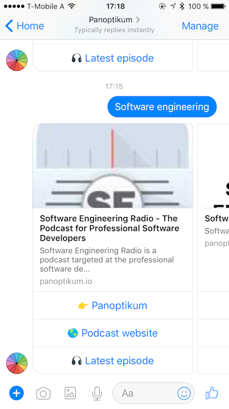

+++
title = "Chatbot for Panoptikum"
date = 2017-08-07
authors = ["Sonja"]
redirect_from = ["/2017/08/07/bot.html"]
+++

Check out Carmens blog post about the chatbot for Panoptikum.

[Breathing Life into the Panoptikum Facebook Messenger Bot with Elixir and Phoenix](https://carmenh.dev/2017/08/05/breathing-life-into-the-panoptikum-facebook-messenger-bot-with-elixir-and-phoenix/)

The chatbot offers the following functionality: based on the reveived message the chatbot answers with some podcast recommendations.

The blog post describes all the tiny details - I recommend it as a cookbook if you want to write your own chatbot. No frameworks are used, everthing is written by Carmen herself which leads to a lean application.
