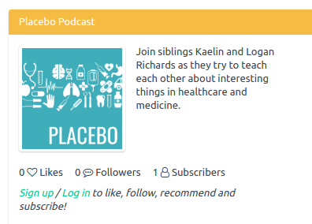
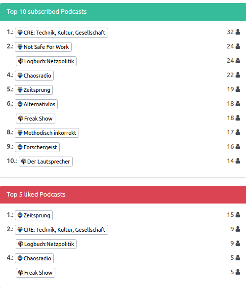

+++
title = "Several minor improvements"
date = 2017-08-21
authors = ["Sonja"]
redirect_from = ["/2017/08/21/improvements.html"]
+++

Some minor details of Panoptikum needed improvement and this week came their time.

* All dates (last modified, publishing date, ..) and the time values of duration are now displayed correctly.

* The podcast page shows the likes, followers and subscribers without login.

* And the charts (Top 10 subscribed Podcasts, Top 5 liked Podcasts) now offer their results ex aequo.

Please report further details that you discover that need improvements. Mail to <sonja@panoptikum.social> or leave a comment under this post.
