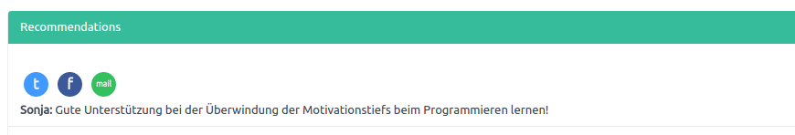
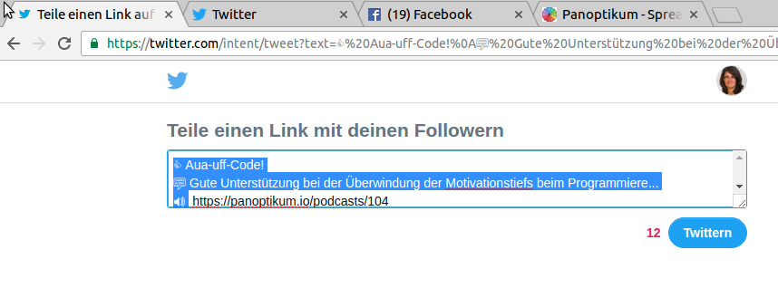
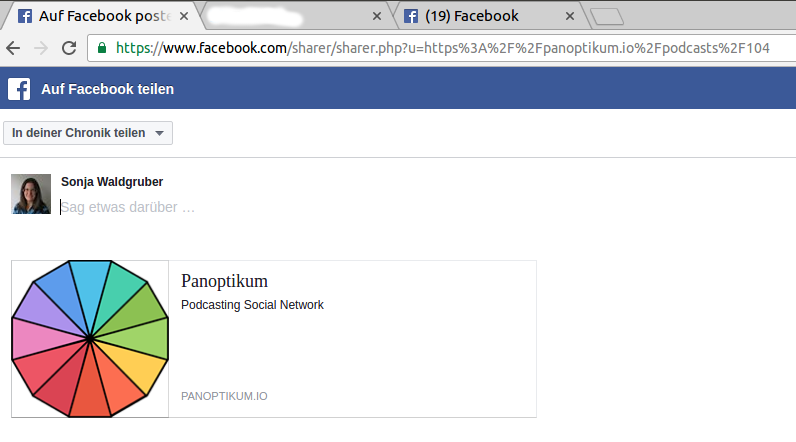
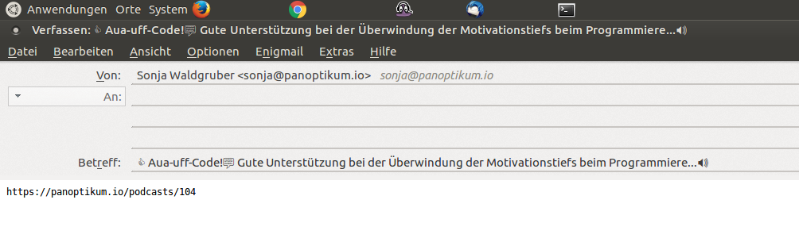
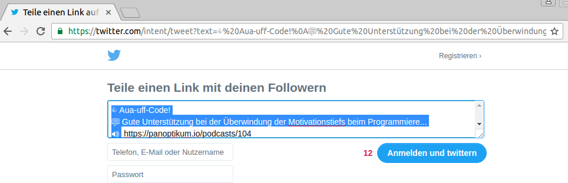

+++
title = "Spread your recommendations"
date = 2017-09-27
authors = ["Sonja"]
redirect_from = ["/2017/09/27/recommendations.html"]
+++

You have written a great recommendation of your favourite podcast and want to spread the word outside Panoptikum?

Above your recommendation in Panoptikum wait three buttons for you to tweet, share or email your recommendation.

"Tweet it" leads to the following screen (if you are already logged in Twitter). You can edit the text before your tweet.

"Share it" leads to the following screen (if you are already logged in Facebook). Facebook does not support the automatic insertion of the text, but you can copy it manually.

"Send an e-Mail" creates an email in your standard mail program. The subject includes your recommendation and the mail body the link to the recommended podcast. You can edit both before send.

If you are not already loggedin in Twitter or Facebook you have one additional step, but it leads to the same result.

Twitter

Facebook

Happy recommending!
