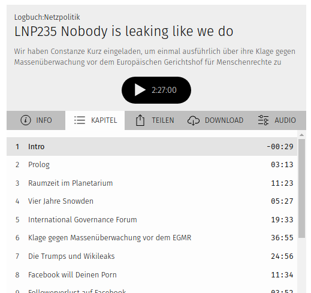
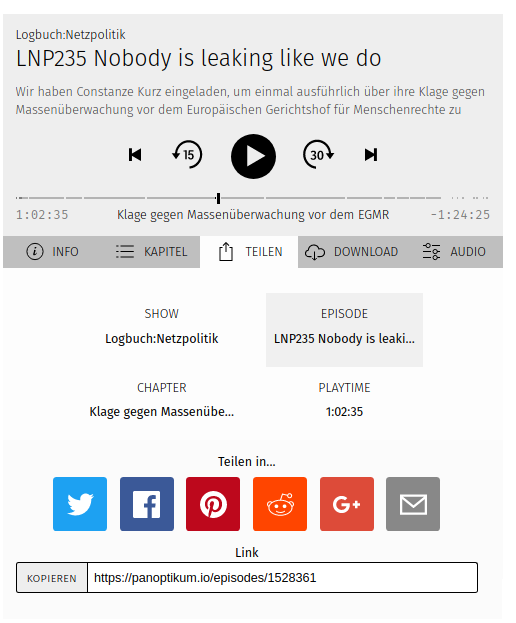
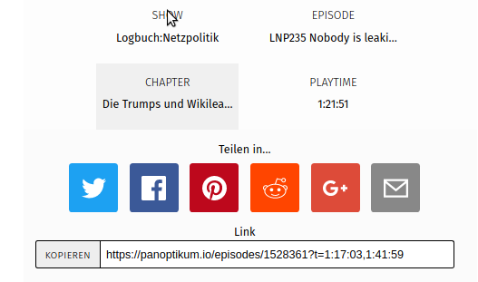
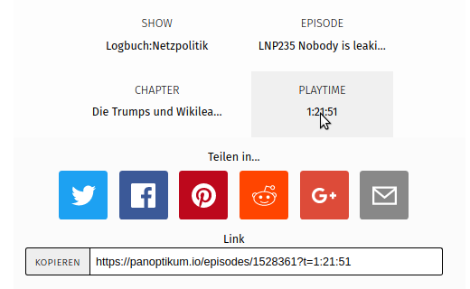
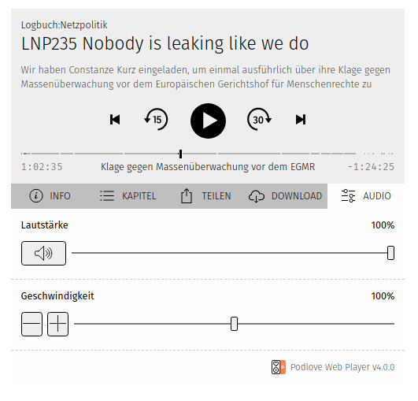

+++
title = "Back to Podlove Web Player"
date = 2017-12-03
authors = ["Sonja"]
redirect_from = ["/2017/12/03/podlove-player.html"]
+++

Panoptikum is back to using the [Podlove Web Player](https://podlove.org/podlove-web-player/) on the episode page.

Why the change back to Podlove Web Player?
* better player all together
* nicer navigation
* deep linking works again

This offers you several functions for listening to a podcast episode directly on the Panoptikum episode page:

## Chapters

You can use the chapters for navigation directly in the web player

## Share

You can share the complete episode,

one chapter

or a minute

## Speed and Volume

You can increase or descrese the speed and adjust the volume

Try it out and please send us feedback (<sonja@panoptikum.social>).
* What do you think about the change?
* Is it an improvement or was it a move in the wrong direction?
* What do you miss?

# Time for some statistics

* 26 682 podcasts
* 1 585 647 episodes
* 225 languages
* 172 categories
* 214 users
* 65 OPML (thank you for your input!)
