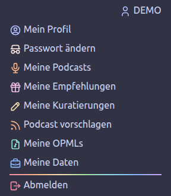
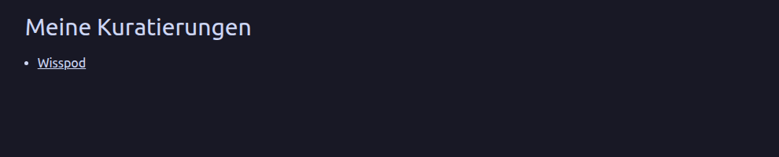
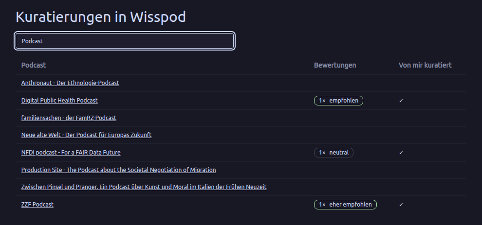
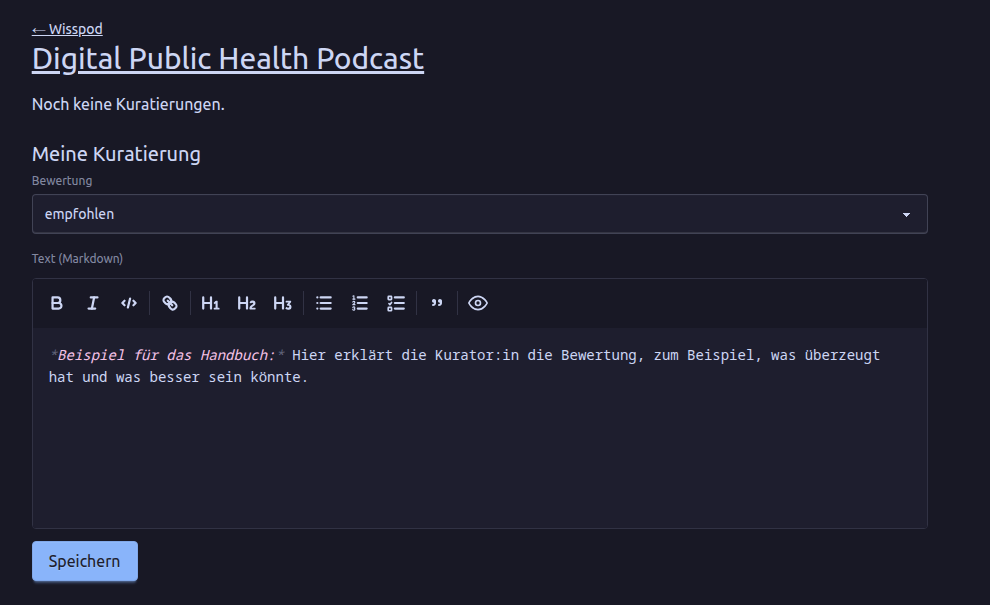
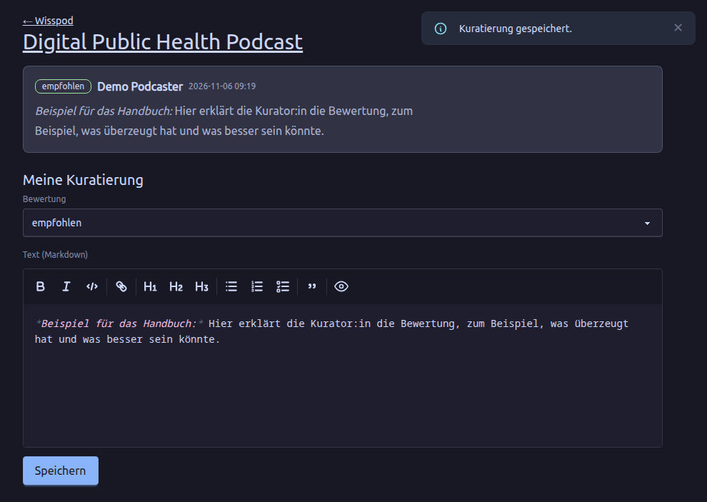
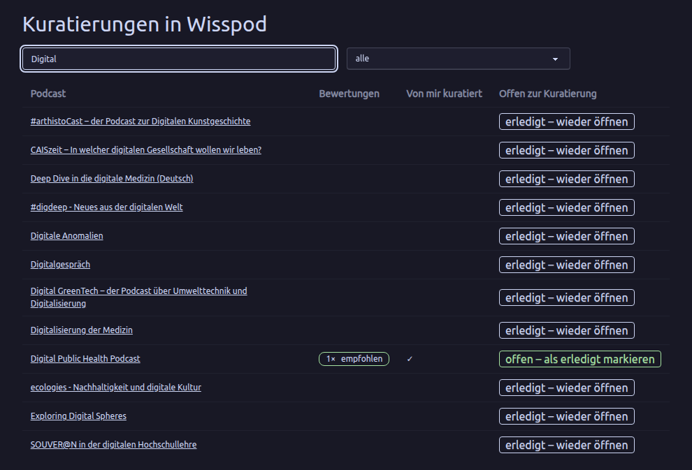

+++
title = "Handbuch für Kurator:innen"
description = "Wie Sie die Podcasts einer Panoptikum-Community kuratieren: Bewertungen und Texte."
menu = "main"
weight = 40
+++

(Es gibt auch ein [Handbuch für Hörer:innen](/manuals/listener-manual), ein [Handbuch für Podcaster:innen](/manuals/podcaster-manual) und ein [Handbuch für Moderator:innen](/manuals/moderator-manual).)

Dieses Handbuch beschreibt Panoptikum aus Sicht der Kurator:innen. Lesen Sie bitte vorher das [Handbuch für Hörer:innen](/manuals/listener-manual).

Die [Communitys](https://panoptikum.social/communities) von Panoptikum sind kuratierte Gruppen von Podcasts und Podcaster:innen zu einem gemeinsamen Thema. Als Kurator:in einer Community bewerten Sie ihre Podcasts: Für jeden Podcast vergeben Sie eine Bewertung und schreiben einen Text, Ihre Kuratierung.

Kuratierungen sind nicht öffentlich. Lesen können sie nur die Kurator:innen und Moderator:innen der Community und die Admins von Panoptikum, nie die Podcaster:innen oder andere Benutzer:innen. Sie erscheinen auch nicht in der Suche oder in der API. Ein Podcast, der zu mehreren Communitys gehört, wird in jeder davon getrennt kuratiert und kann dort unterschiedliche Bewertungen bekommen.

Die Bilder zeigen einen Demo-Account, „Demo Podcaster“, als Kurator:in der Community Wisspod, mit Beispiel-Kuratierungen.

## Kurator:in werden

Eine Moderator:in der Community macht Sie zur Kurator:in und weist Sie der Community zu. Nennen Sie ihr einfach Ihren Benutzernamen auf Panoptikum. Auch die Admins können das.

Als Kurator:in finden Sie den Eintrag **Meine Kuratierungen** im Menü unter Ihrem Benutzernamen in der Seitenleiste.

## Meine Kuratierungen

**Meine Kuratierungen** listet die Communitys, die Sie kuratieren. Ein Klick auf eine Community öffnet ihre Kuratierungen.

## Die Kuratierungen einer Community

Die Seite „Kuratierungen in“ mit dem Namen der Community listet die Podcasts, die zur Kuratierung offen sind. Mit dem Feld „Podcast-Titel“ können Sie darin suchen. Die Tabelle zeigt:

* **Podcast**: den Titel des Podcasts, verlinkt mit seiner Kuratierungsseite.
* **Bewertungen**: die bisherigen Bewertungen des Podcasts, zum Beispiel „2× empfohlen“ und „1× neutral“.
* **Von mir kuratiert**: ein ✓, wenn Sie den Podcast schon kuratiert haben.

Neue Podcasts einer Community sind von Anfang an zur Kuratierung offen. Wenn die Moderator:innen entscheiden, dass ein Podcast genug kuratiert ist, markieren sie ihn als erledigt, und er verschwindet aus Ihrer Liste.

## Einen Podcast kuratieren

Ein Klick auf einen Podcast öffnet seine Kuratierungsseite. Oben führt ein Link zurück zur Community; der Titel des Podcasts führt zu seiner öffentlichen Seite auf Panoptikum, wo Sie seine Episoden anhören können.

Darunter stehen die Kuratierungen aller Kurator:innen dieser Community, jede mit ihrer Bewertung, dem Namen der Kurator:in und dem Datum der letzten Änderung. Hat eine Kurator:in ihr Konto gelöscht, steht statt des Namens „ehemalige:r Kurator:in“.

Unter **Meine Kuratierung** schreiben Sie Ihre eigene:

* **Bewertung**: Wählen Sie eine von empfohlen, eher empfohlen, neutral, eher abgelehnt und abgelehnt. Eine Bewertung ist Pflicht.
* **Text (Markdown)**: warum Sie den Podcast so bewertet haben. Der Text kann Markdown enthalten, zum Beispiel **Fettdruck**, Listen, Tabellen und Links. Bilder werden nicht angezeigt, nur ihr Alternativtext.
* **Speichern** speichert Ihre Kuratierung.

Nach dem Speichern erscheint Ihre Kuratierung über dem Formular:

Sie haben pro Podcast in jeder Community eine Kuratierung. Öffnen Sie die Seite erneut, zeigt das Formular Ihre Kuratierung, und **Speichern** ersetzt sie durch Ihre Änderungen. Kuratierungen lassen sich nicht löschen, aber Sie können sie ändern, solange der Podcast zur Kuratierung offen ist.

Ist ein Podcast erledigt, zeigt seine Seite „Die Kuratierung dieses Podcasts ist abgeschlossen.“ und kein Formular mehr.

## Für Moderator:innen

Moderator:innen einer Community können unter **Meine Kuratierungen** alle ihre Kuratierungen lesen, auch wenn sie selbst keine Kurator:innen sind. In der Liste einer Community sehen sie auch die erledigten Podcasts, mit einem Filter für „offen zur Kuratierung“, „erledigt“ und „alle“, und eine Spalte **Offen zur Kuratierung**:

* **offen – als erledigt markieren** markiert den Podcast nach einer Rückfrage als erledigt. Er verschwindet aus der Liste der Kurator:innen.
* **erledigt – wieder öffnen** macht ihn wieder zur Kuratierung offen.

Um selbst Kuratierungen zu schreiben, weisen sich Moderator:innen als Kurator:innen der Community zu, siehe das [Handbuch für Moderator:innen](/manuals/moderator-manual).
