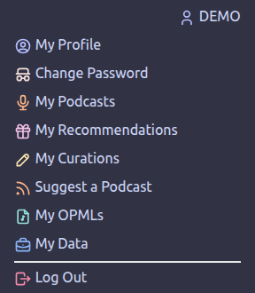
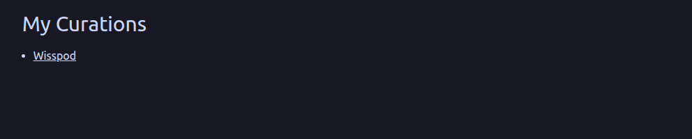
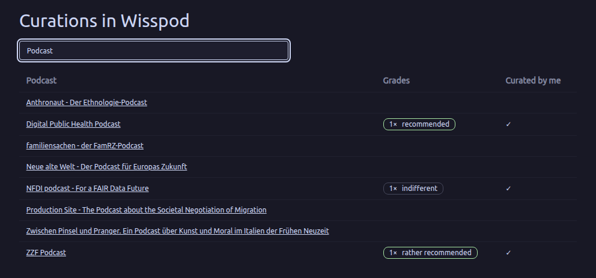
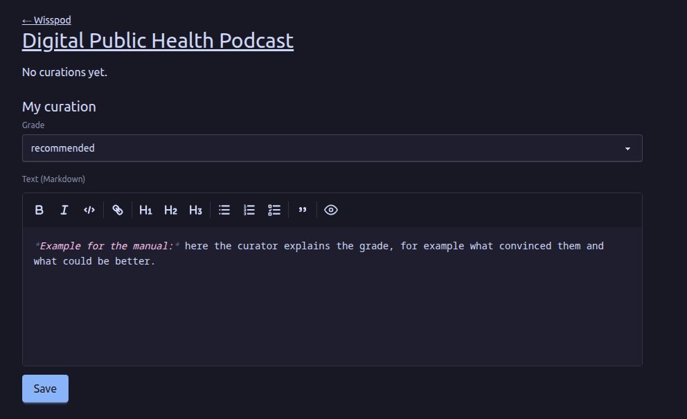
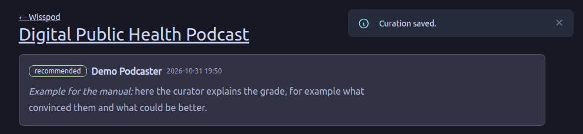
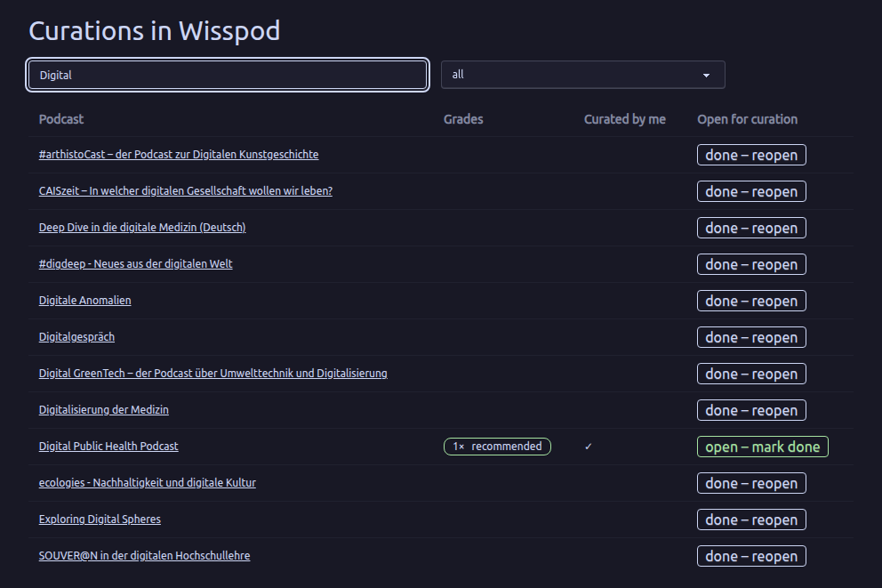

+++
title = "Curator Manual"
description = "How to curate the podcasts of a Panoptikum community: grades and texts."
menu = "main"
weight = 40
+++

(There are also a [Listener Manual](/manuals/listener-manual), a [Podcaster Manual](/manuals/podcaster-manual) and a [Moderator Manual](/manuals/moderator-manual).)

This manual describes the use of Panoptikum from the curator perspective. Please read the [Listener Manual](/manuals/listener-manual) before this one.

Panoptikum's [communities](https://panoptikum.social/communities) are curated groups of podcasts and podcasters around a shared theme. As a curator of a community you assess its podcasts: for each podcast you give a grade and write a text, your curation.

Curations are not public. Only the curators and moderators of the community and the Panoptikum admins can read them, never the podcasters or other users. They don't show up in the search or the API either. A podcast that belongs to several communities is curated in each of them separately, and it can get different grades there.

The pictures show a demo user, "Demo Podcaster", as curator of the community Wisspod, with example curations.

## Becoming a Curator

A moderator of the community makes you a curator and assigns you to the community. Just tell them your username on Panoptikum. The admins can do that too.

As a curator you find the entry **My Curations** in the menu below your user name in the sidebar.

## My Curations

**My Curations** lists the communities you curate. A click on a community opens its curations.

## The Curations of a Community

The page "Curations in" and the name of the community lists the podcasts that are open for curation. With the field "Podcast title" you can search them. The table shows:

* **Podcast**: the podcast's title, linked to its curation page.
* **Grades**: the grades the podcast got so far, for example "2× recommended" and "1× indifferent".
* **Curated by me**: a ✓ if you have curated the podcast already.

New podcasts in a community are open for curation from the start. When the moderators decide that a podcast is curated enough, they mark it as done, and it disappears from your list.

## Curating a Podcast

A click on a podcast opens its curation page. At the top a link leads back to the community; the podcast's title leads to its public page on Panoptikum, where you can listen to its episodes.

Below you find the curations of all curators of this community, each with its grade, the curator's name and the date of the last change. If a curator has deleted their account, "former curator" shows instead of the name.

Under **My curation** you write your own:

* **Grade**: choose one of recommended, rather recommended, indifferent, rather declined and declined. A grade is required.
* **Text (Markdown)**: why you graded the podcast that way. The text supports Markdown, for example **bold**, lists, tables and links. Images aren't shown, only their alternative text.
* **Save** stores your curation.

After saving, your curation shows above the form:

You have one curation per podcast in each community. When you open the page again, the form shows your curation, and **Save** replaces it with your changes. Curations can't be deleted, but you can change them as long as the podcast is open for curation.

If a podcast is done, its page shows "Curation of this podcast is done." and no form any more.

## For Moderators

Moderators of a community can read all its curations under **My Curations**, even if they aren't curators themselves. In the list of a community they also see the podcasts that are done, with a filter for "open for curation", "done" and "all", and a column **Open for curation**:

* **open – mark done** marks the podcast as done, after you have confirmed it. It disappears from the curators' list.
* **done – reopen** makes it open for curation again.

To write curations, moderators assign themselves as curators of the community, see the [Moderator Manual](/manuals/moderator-manual).
