+++
title = "Handbuch für Hörer:innen"
description = "Wie Sie Panoptikum als Podcast-Hörer:in nutzen."
menu = "main"
weight = 10
+++

(Es gibt auch ein [Handbuch für Podcaster:innen](/manuals/podcaster-manual), ein [Handbuch für Moderator:innen](/manuals/moderator-manual) und ein [Handbuch für Kurator:innen](/manuals/curator-manual), siehe die [Übersicht aller Handbücher](/manuals).)

Dieses Handbuch beschreibt Panoptikum aus Sicht der Hörer:innen.
Panoptikum bietet Grundfunktionen und für registrierte Benutzer:innen
weitere Funktionen.

Die Bilder zeigen noch die englische Oberfläche.

Grundfunktionen für Hörer:innen

* Neueste Empfehlungen
* Neueste Podcasts
* Neueste Episoden
* Top 10 der meistabonnierten Podcasts
* Top 10 der beliebtesten Podcasts
* Podcasts entdecken: über Kategorien, Communitys, den Zufall und die Suche

Panoptikum bietet Ihnen die Möglichkeit, neue Podcasts für Ihren Podcatcher
zu entdecken.

## Startseite

Die Startseite von Panoptikum bietet Ihnen viele Möglichkeiten, neue Podcasts
zu entdecken.

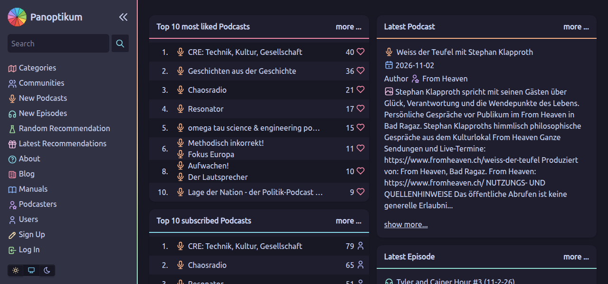

### Neueste Empfehlungen

Registrierte Benutzer:innen können persönliche Empfehlungen für Podcasts schreiben.
Unter den neuesten Empfehlungen sehen Sie den Namen des Podcasts, den Benutzernamen
der empfehlenden Person, das Datum der Empfehlung und ihren Text.

Mit einem Klick auf ...

* den Namen des Podcasts kommen Sie auf die Panoptikum-Seite dieses Podcasts mit
  weiteren Informationen
* den Benutzernamen bekommen Sie eine Liste aller Podcasts, die dieser Person gefallen
* „mehr anzeigen ...“ bekommen Sie die 15 neuesten persönlichen Empfehlungen und mehr

### Neueste Podcasts

Unter den neuesten Podcasts finden Sie die Podcasts, die zuletzt von registrierten
Benutzer:innen oder vom Panoptikum-Team über den Upload ihrer OPML-Datei in die
Datenbank aufgenommen wurden. Sie sehen den Namen der Podcasts, die Namen der
Mitwirkenden, das Datum, an dem der Podcast aufgenommen wurde („Verfügbar seit“),
und die Beschreibung des Podcasts.

Mit einem Klick auf ...

* den Namen des Podcasts kommen Sie auf die Panoptikum-Seite dieses Podcasts mit
  weiteren Informationen
* den Namen einer Mitwirkenden kommen Sie auf ihre Panoptikum-Seite mit weiteren
  Informationen
* „mehr anzeigen ...“ bekommen Sie die 10 neuesten Podcasts und mehr

### Neueste Episoden

Unter den neuesten Episoden finden Sie die Podcast-Episoden, die zuletzt
veröffentlicht wurden. Panoptikum prüft die gelisteten Podcast-Feeds regelmäßig auf
neue Episoden und übernimmt die Informationen zur Episode aus dem Feed. Sie sehen den
Titel der Episode, den Namen des Podcasts, die Namen der Mitwirkenden sowie Datum
und Uhrzeit der Veröffentlichung.

Mit einem Klick auf ...

* den Titel der Episode kommen Sie auf die Panoptikum-Seite dieser Episode mit
  weiteren Informationen und können sie direkt im eingebauten Player anhören
* den Namen des Podcasts kommen Sie auf die Panoptikum-Seite dieses Podcasts mit
  weiteren Informationen
* den Namen einer Mitwirkenden kommen Sie auf ihre Panoptikum-Seite mit weiteren
  Informationen zu Gigs und Beiträgen
* „mehr anzeigen ...“ bekommen Sie die 10 neuesten Episoden und mehr

### Top 10 der meistabonnierten Podcasts

Registrierte Benutzer:innen können die OPML-Datei hochladen, die ihr Podcatcher
exportiert. Jeder Podcast in der OPML-Datei wird dann auf Panoptikum gelistet. Aus der
Zahl der registrierten Benutzer:innen, die denselben Podcast gelistet haben, ermittelt
Panoptikum die Top 10 der meistabonnierten Podcasts. Sie sehen den Namen des Podcasts
und die Zahl der Benutzer:innen, die ihn abonniert haben. Mit einem Klick auf den Namen
des Podcasts kommen Sie auf die Panoptikum-Seite dieses Podcasts mit weiteren
Informationen.

### Top 10 der beliebtesten Podcasts

Registrierte Benutzer:innen können einen Podcast liken. Das ist unabhängig vom
Abonnement: Man kann einen Podcast liken, ohne ihn zu abonnieren. Sie sehen den Namen
des Podcasts und die Zahl der Benutzer:innen, denen er gefällt. Mit einem Klick auf den
Namen des Podcasts kommen Sie auf die Panoptikum-Seite dieses Podcasts mit weiteren
Informationen.

Der Gedanke dahinter: Ein Podcast kann Ihnen gefallen, auch wenn Sie keine Zeit mehr
finden, ihn zu hören. Es gibt einfach zu viele gute Podcasts :-)

### Podcasts entdecken: die Seitenleiste

Die Seitenleiste links auf jeder Seite enthält ein Suchfeld und das Menü:

* [Kategorien](https://panoptikum.social/categories): Ein Podcast kann Kategorien
  zugeordnet sein. Daraus zeigt Panoptikum, welche gelisteten Podcasts es in jeder
  Kategorie gibt. Es gibt Haupt- und Unterkategorien. Mit einem Klick auf eine
  Kategorie kommen Sie auf ihre Panoptikum-Seite und sehen die Unterkategorien und
  alle gelisteten Podcasts (nach Sprache sortiert) dieser Kategorie.
* [Communitys](https://panoptikum.social/communities): kuratierte Gruppen von Podcasts
  und Podcaster:innen zu einem gemeinsamen Thema, jede mit eigenen Moderator:innen und
  Mitgliedern. Auf der Seite einer Community können Sie ihre Podcasts durchsehen, die
  neuesten Episoden ihrer Podcasts als Zeitleiste verfolgen, ihre Podcasts nach ihren
  anderen Kategorien sortiert sehen, und Sie finden ihre Moderator:innen und Mitglieder.
* **Neue Podcasts** und **Neue Episoden**: die neuesten Podcasts und Episoden wie auf
  der Startseite, nur mehr davon.
* [Zufällige Empfehlung](https://panoptikum.social/recommendations/random): Panoptikum
  bietet viele strukturierte Wege, neue Podcasts zu entdecken: Empfehlungen, neueste
  Podcasts, neueste Episoden, die meistabonnierten, die beliebtesten und den
  Kategorienbaum. Mit dem Zufall entdecken Sie einen neuen Podcast durch Glück. Mit
  einem Klick auf „Zufällige Empfehlung“ entscheidet Fortuna, welcher der auf Panoptikum
  gelisteten Podcasts mit einer Episode gezeigt wird.
* **Neueste Empfehlungen**: die neuesten Empfehlungen aller Benutzer:innen.
* **Über Panoptikum**, **Blog** und **Handbücher**: die Panoptikum-Website mit
  Neuigkeiten und diesen Handbüchern.
* [Podcaster:innen](https://panoptikum.social/personas): die Menschen hinter den
  Podcasts, siehe das [Handbuch für Podcaster:innen](/manuals/podcaster-manual).
* **Benutzer:innen**: die registrierten Benutzer:innen von Panoptikum.

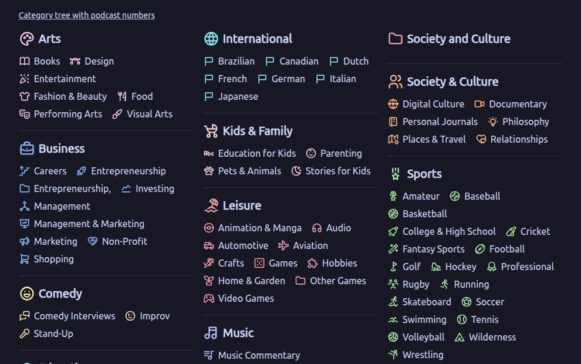

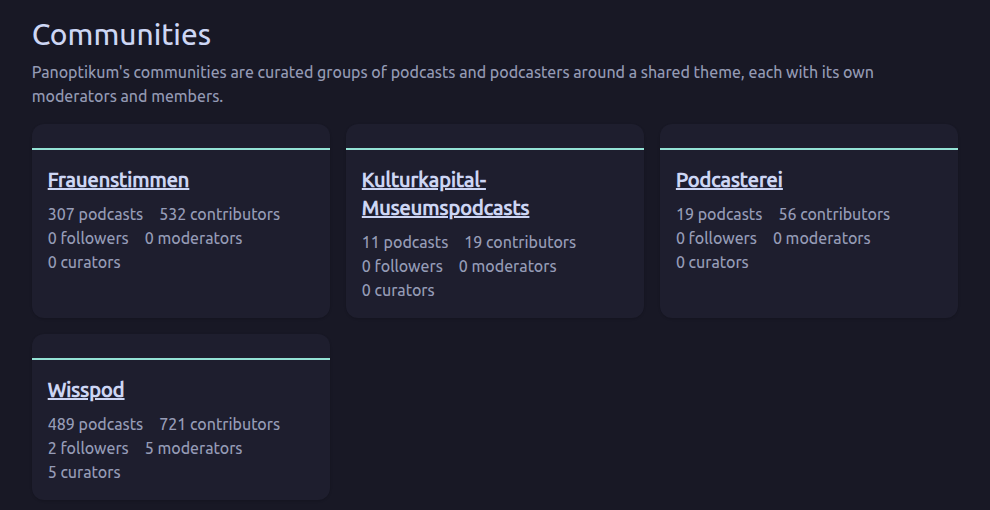

Der Button mit den zwei Pfeilen neben dem Panoptikum-Logo klappt die Seitenleiste
ein und aus.

Suche: Geben Sie einfach einen oder mehrere Begriffe in das Suchfeld ein, und
Panoptikum zeigt Ihnen die Treffer in Episoden, nach Relevanz sortiert.
Die Links über den Treffern wechseln zu Podcasts, Personas und Kategorien.
[Beispiel: Personas mit „Stefan“ im Namen](https://panoptikum.social/search/personas/Stefan)


### Heller und dunkler Modus

Die drei Buttons unten in der Seitenleiste wählen das Aussehen von Panoptikum:
die Sonne für hell, der Mond für dunkel und der Bildschirm dazwischen, um der
Einstellung Ihres Systems zu folgen – das ist auch der Standard. Ihr Browser merkt
sich die Wahl.

### Sprache

Mit den Buttons EN und DE darunter wählen Sie die Sprache von Panoptikum: Englisch
oder Deutsch. Ohne Wahl richtet sich Panoptikum nach der Sprache Ihres Browsers. Sind
Sie angemeldet, wird die Wahl in Ihrem Konto gespeichert und gilt dann auf allen Ihren
Geräten. Inhalte, die Menschen schreiben – Podcast- und Episodendaten, Empfehlungen,
Texte von Communitys –, bleiben in ihrer Sprache.

### Episoden anhören

Panoptikum verwendet auf der Seite einer Episode den
[Podlove Web Player](https://podlove.org/podlove-web-player/). Er bietet Ihnen
mehrere Funktionen, um eine Episode direkt auf der Panoptikum-Seite anzuhören:

Kapitel: Mit den Kapiteln können Sie direkt im Web Player navigieren. Das Kapitel,
das Sie gerade hören, ist markiert.
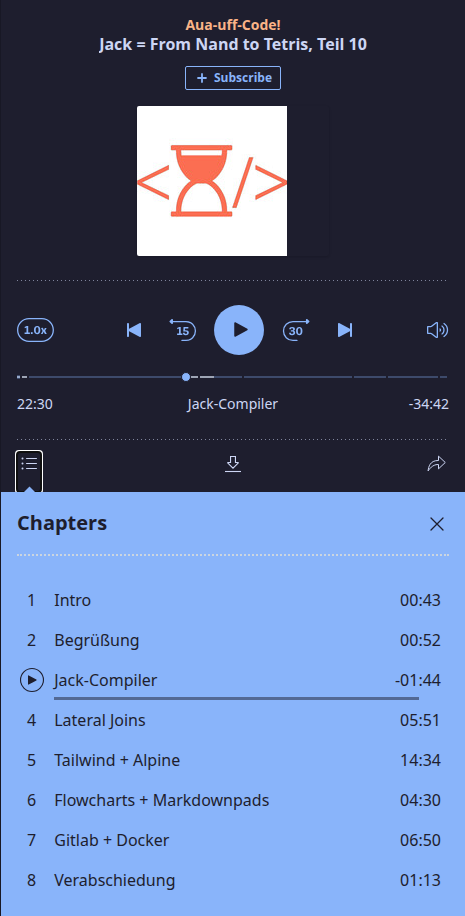
Geschwindigkeit und Lautstärke: Sie können die Geschwindigkeit erhöhen oder
verringern (der Button 1.0x links von den Steuerelementen) und die Lautstärke
anpassen (der Lautsprecher rechts von den Steuerelementen), siehe das Bild oben.

Episode teilen: Sie können die ganze Episode teilen.
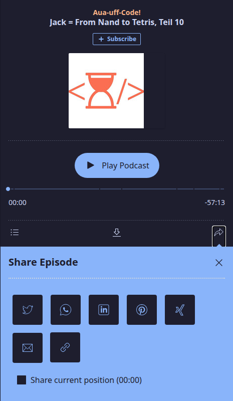
Ab einer Stelle teilen: Kreuzen Sie „Aktuelle Position teilen“ an, um die Episode ab
der Stelle zu teilen, an der Sie gerade hören.
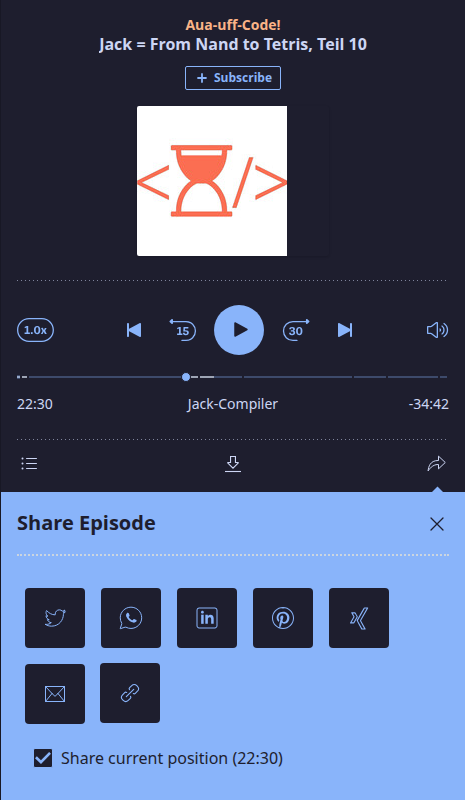
Dateien: Sie können die Audiodatei der Episode herunterladen.
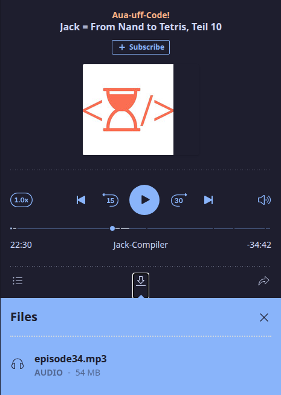

### Statistik

Die Seite [Kategorien](https://panoptikum.social/categories) bietet einen guten
Überblick. Für alle, die Zahlen lieben und genau wissen möchten, wie viele Podcasts
in einer Kategorie sind, gibt es die versteckte Statistik. Probieren Sie es aus:
[https://panoptikum.social/categories/stats](https://panoptikum.social/categories/stats).
Dort steht die Zahl der Podcasts pro Kategorie bei der Ansicht der Kategorien. Das
funktioniert auch innerhalb einer Kategorie. Unter
[https://panoptikum.social/categories/13/stats](https://panoptikum.social/categories/13/stats)
sehen Sie zum Beispiel, wie viele Podcasts es pro Sprache gibt. Weil die Podcasts
dafür erst gezählt werden müssen, dauert der Aufbau dieser Seite etwas länger. Bitte
haben Sie Geduld!

## Registrierung

Nach der Anmeldung bietet Panoptikum weitere Funktionen:

* Podcasts und Episoden empfehlen und liken
* Neue Podcasts vorgeschlagen bekommen, ausgehend von Ihren Abonnements und Likes
* Einen neuen Podcast vorschlagen
* OPML-Dateien hochladen, um mehrere Podcasts auf einmal vorzuschlagen

### Registrieren

In der Seitenleiste jeder Seite finden Sie einen Link zum Anmelden. Auf der
Anmeldeseite können Sie sich [registrieren](https://panoptikum.social/users/new)
und werden registrierte Benutzer:in.

Sie werden nach einer E-Mail-Adresse (nötig zur Wiederherstellung des Passworts),
einem Benutzernamen (für Ihre Bewertungen, Kommentare und Likes) und einem Passwort
(zum Anmelden) gefragt. Sie können jeden Benutzernamen wählen, der in Panoptikum noch
nicht vergeben ist. Das Formular fragt außerdem nach Ihrem Namen, ob Sie Podcaster:in
sind, und stellt eine kleine Frage, die Menschen von Bots unterscheidet.

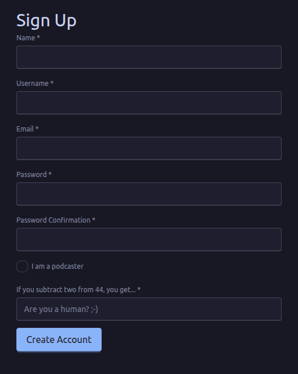

Nach **Konto anlegen** schickt Ihnen Panoptikum eine E-Mail mit einem Link, um Ihre
E-Mail-Adresse zu bestätigen. Sobald Sie diesen Link genutzt haben, können Sie sich
anmelden.

Panoptikum fragt (und speichert) nur Angaben, die für den Dienst nötig sind. Neben den
Angaben bei der Registrierung verwendet Panoptikum Ihre hochgeladene Abonnementliste
(OPML-Datei), um Podcasts in die Podcast-Datenbank von Panoptikum aufzunehmen. Es
speichert und veröffentlicht, dass Sie den Podcast abonniert haben. Panoptikum
speichert und veröffentlicht Ihre Bewertungen, Kommentare und Likes.

## Weitere Funktionen nach der Anmeldung

In der Seitenleiste jeder Seite finden Sie einen Link zum
[Anmelden](https://panoptikum.social/sessions/new). Nach der Anmeldung sehen Sie Ihren
Benutzernamen in der Seitenleiste (im Beispiel unten ist der Benutzername „demo“).
Unter Ihrem Benutzernamen finden Sie ein Menü mit diesen Funktionen:

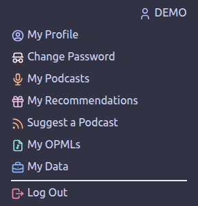

Moderator:innen und Kurator:innen einer Community finden dort zwei weitere Einträge,
**Meine Moderationen** und **Meine Kuratierungen**, siehe das
[Handbuch für Moderator:innen](/manuals/moderator-manual) und das
[Handbuch für Kurator:innen](/manuals/curator-manual).

### Mein Profil

Hier sehen und bearbeiten Sie Ihre Daten (Name, Benutzername, E-Mail, Podcaster:in
ja/nein, Teilen, wem Sie folgen, ja/nein, Teilen der Abonnements ja/nein) und die
Sprachen, die Sie sprechen.

### Passwort ändern

Hier ändern Sie Ihr Passwort.

### Meine Podcasts

Sie sehen Informationen über sich

* Abonnements
* Podcasts, die mir gefallen
* Podcasts, denen ich folge

und bekommen daraus Vorschläge für neue Podcasts

* Wer Ihre Podcasts hört, hört auch
* Wem dieselben Podcasts gefallen wie Ihnen, dem gefällt auch
* Die Kategorien meiner Podcasts

Podcaster:innen finden dort auch die Podcasts, die sie verwalten, siehe das
[Handbuch für Podcaster:innen](/manuals/podcaster-manual).

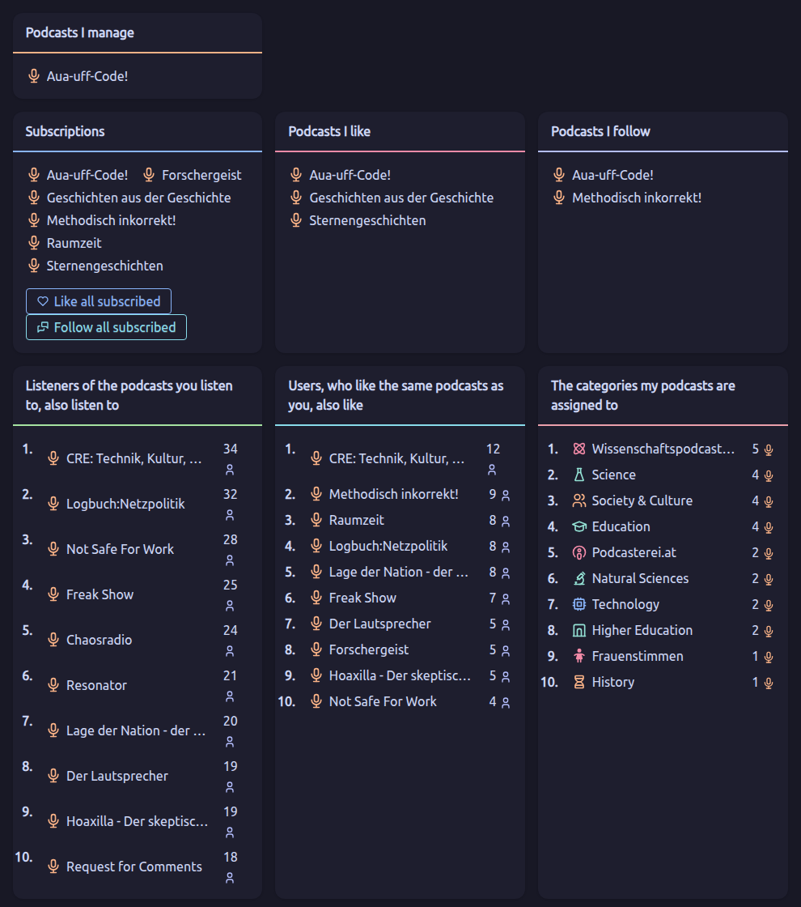

### Meine Empfehlungen

Sie sehen Ihre Podcast-Empfehlungen und können abonnierte Podcasts empfehlen, die Sie
noch nicht empfohlen haben.

### Podcast vorschlagen

Ein Podcast wird auf Panoptikum gelistet, wenn ihn mindestens eine registrierte
Benutzer:in abonniert hat. Möchten Sie nur einen Podcast hinzufügen, nutzen Sie
<kbd>Podcast vorschlagen</kbd>.

Sie werden dann in der Datenbank als Abonnent:in gezählt. Möchten Sie mehrere oder alle
Podcasts, die Sie hören, auf einmal vorschlagen, können Sie über <kbd>Meine OPMLs</kbd>
in Ihrem persönlichen Menü eine OPML-Datei hochladen.

### Meine OPMLs

<kbd>Meine OPMLs</kbd> öffnet den Dialog zum Hochladen der OPML-Datei.
Ihr Podcatcher (zum Beispiel gPodder) kann die Liste Ihrer Podcast-Abonnements
exportieren (gPodder: Abonnements – zu OPML-Datei exportieren). Diese OPML-Datei ist
Ihre Abonnementliste, die Sie nach der Anmeldung auf Panoptikum hochladen können.
Laden Sie Ihre Abonnementliste mehr als einmal hoch, ergänzt der neueste Upload die
bisherige Liste. Mit dem Upload der Datei unterstützen Sie Panoptikum – die Angaben
werden für die Listung von Podcasts und für Vorschläge neuer Podcasts aus Ihren
Abonnements und Likes gebraucht.

### Meine Daten

<kbd>Meine Daten</kbd> öffnet die Seite „Konto“, bietet alle Ihre Daten mit einem
Button zum Herunterladen als JSON-Datei an und zeigt Ihnen alle gespeicherten Daten.
Sie können prüfen, was in den einzelnen Bereichen gespeichert ist, und es pro Bereich
löschen. Im Bereich selbst können Sie entweder alle Einträge oder einzelne Einträge
löschen.

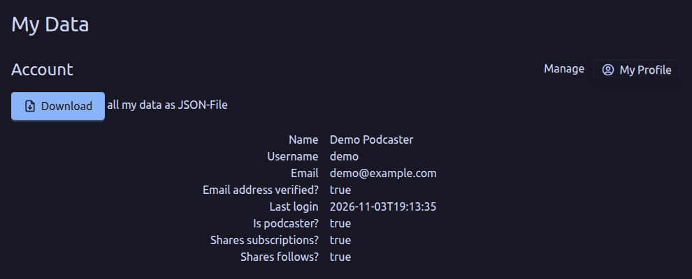

Bereiche und Möglichkeiten

* OPML-Dateien: Liste der hochgeladenen Dateien, verwaltbar unter „Meine OPMLs“
* Personas: Überblick über Ihre Personas
* Rechnungen: alle Ihre Panoptikum-Rechnungen mit Datum und Datei
* Abonnierte Podcasts: Liste aller Ihrer Abonnements (mit Links zur Seite des Podcasts)
* Podcasts, denen ich folge: Liste aller Podcasts, denen Sie folgen (mit Links zur
  Seite des Podcasts)
* Podcasts, die mir gefallen: Liste aller Podcasts, die Ihnen gefallen (mit Links zur
  Seite des Podcasts)
* Episoden, die mir gefallen: Liste aller Episoden, die Ihnen gefallen (mit Links zur
  Seite der Episode)
* Kapitel, die mir gefallen: Liste aller Kapitel, die Ihnen gefallen (mit Links zur
  Seite der Episode)
* Benutzer:innen, die mir gefallen: Liste aller Benutzer:innen, die Ihnen gefallen (mit
  Links zu ihrer Profilseite)
* Benutzer:innen, denen ich folge: Liste aller Benutzer:innen, denen Sie folgen (mit
  Links zu ihrer Profilseite)
* Personas, denen ich folge: Liste aller Personas, denen Sie folgen (mit Links zur
  Seite der Persona)
* Personas, die mir gefallen: Liste aller Personas, die Ihnen gefallen (mit Links zur
  Seite der Persona)
* Kategorien, denen ich folge: Liste aller Kategorien, denen Sie folgen (mit Links zur
  Seite der Kategorie)
* Kategorien, die mir gefallen: Liste aller Kategorien, die Ihnen gefallen (mit Links
  zur Seite der Kategorie)
* Empfehlungen: Liste aller Ihrer Empfehlungen mit ihrem Text und dem Namen des
  empfohlenen Podcasts oder der empfohlenen Episode

Die Seite endet mit der Gefahrenzone. Dort können Sie Ihr Konto direkt löschen.
Mit <kbd>Mein Konto löschen</kbd> wird Ihr Konto samt allen gespeicherten Daten
gelöscht.

Panoptikum kann Ihr Konto danach nicht wiederherstellen, Sie können sich aber jederzeit
neu bei Panoptikum registrieren.

## Empfehlungen und Likes

Nach der Anmeldung haben Sie auf den verschiedenen Seiten weitere Möglichkeiten:

* Podcast: empfehlen, liken und folgen
* Episode: empfehlen und liken
* Kapitel einer Episode: empfehlen

Auf der Seite eines Podcasts zeigen die Buttons, wie vielen Benutzer:innen der Podcast gefällt, wie viele ihm folgen und ihn abonniert haben; ein Klick liked, folgt oder abonniert – oder nimmt das zurück.


Auf der Seite eines Podcasts schreiben Sie Ihre Empfehlung in das Feld
„Ihre Empfehlung“ und schicken sie mit <kbd>Empfehlen</kbd> ab.
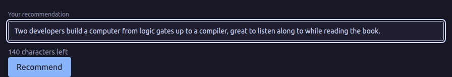

Sie haben eine großartige Empfehlung für Ihren Lieblingspodcast geschrieben und
möchten sie auch außerhalb von Panoptikum verbreiten?

Unter Ihrem Namen, neben Ihrer Empfehlung auf Panoptikum, warten zwei Buttons darauf,
Ihre Empfehlung zu tweeten oder per E-Mail zu verschicken.
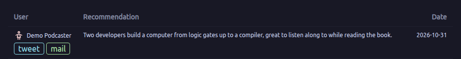

### Twitter

„tweeten“ öffnet X (Twitter) mit Ihrer Empfehlung und dem Link zum Podcast als Text,
den Sie vor dem Posten noch bearbeiten können.

### E-Mail

„E-Mail“ erstellt eine E-Mail in Ihrem Standard-Mailprogramm. Der Betreff enthält den
Podcast und Ihre Empfehlung, der Text der E-Mail den Link zum empfohlenen Podcast.
Beides können Sie vor dem Senden bearbeiten. Für die Empfehlung oben sieht das so aus:

```
Subject: 👍 Aua-uff-Code!
         💬 Two developers build a computer from logic gates up to a compiler, great to listen along to while reading the book.
         🔊

https://panoptikum.social/podcasts/104
```
