+++
title = "Listener Manual"
description = "How to use Panoptikum as a podcast listener."
menu = "main"
weight = 10
redirect_from = ["/listener-manual"]
+++

(There are also a [Podcaster Manual](/manuals/podcaster-manual), a [Moderator Manual](/manuals/moderator-manual) and a [Curator Manual](/manuals/curator-manual), see the [overview of all manuals](/manuals).)

This manual describes the use of Panoptikum from the listener perspective.
Panoptikum.social offers basic functionality plus additional functionality for
registered users.

Basic functionality for listeners

* Latest recommendations
* Latest podcasts
* Latest episodes
* Top 10 subscribed podcasts
* Top 10 liked podcasts
* Podcast discovery: categories, communities, random, search

Panoptikum offers you the chance to discover new podcasts for your
podcatcher.

## Start Page

The start page of Panoptikum offers you a wide range of possibilities
to discover new podcasts.

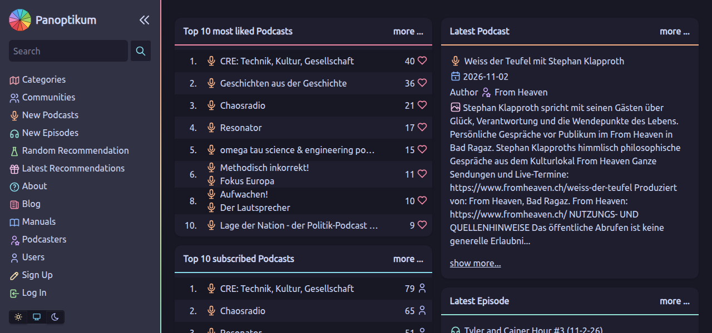

### Latest Recommendations

Registered users can write personal recommendations for podcasts. Under
latest recommendations you see the name of the podcast, the username of the
recommender, the date of the recommendation and the recommendation text.

With a click on ...

* the name of the podcast you reach the Panoptikum page of this podcast
  with further information
* the username you get a list of all the podcasts liked by this user
* more... you get the latest 15 personal recommendations and more

### Latest Podcasts

Under latest podcasts you find those podcasts that were recently added
by registered users or the Panoptikum team to the database via upload
of their OPML file. You see the name of the podcasts, the names of
contributors, the date, when the podcast was added (available since)
and the description of the podcast.

With a click on ...

* the name of the podcast you reach the Panoptikum page of this
  podcast with further information
* the name of a contributor you reach the Panoptikum page of the
  contributor with further information
* more... you get the 10 latest podcasts and more

### Latest Episodes

Under latest episodes you find those podcast episodes, that were
recently published. Panoptikum regularly checks the listed podcast
feeds for new episodes and gets the episode information from the feed.
You see the title of the episode, the name of the podcast, the
names of the contributors and date plus publishing time.

With a click on ...

* the title of the episode you reach the Panoptikum page of this
  episode with further information and you can directly listen to it
  via the embedded player
* the name of the podcast you reach the Panoptikum page of this
  podcast with further information
* the name of a contributor you reach the Panoptikum page of the
  contributor with further information on gigs and contributions
* more... you get the 10 latest episodes and more

### Top 10 subscribed Podcasts

The registered users can upload the OPML-file exported from their
podcatcher. Each podcast included in the OPML-file is then listed in
Panoptikum. Based on the number of registered users that listed the
same podcast Panoptikum can derive, which are the top 10 subscribed
podcasts of its registered users. You see the name of the podcast and the
number of users that have subscribed to this podcast. With a click
on the name of the podcast you reach the Panoptikum page of this
podcast with further information.

### Top 10 Liked Podcasts

The registered users can like a podcast. This is independent from the
subscription. A user can like a podcast without a subscription to it.
You see the name of the podcast and the number of users that have
liked it. With a click on name of the podcast you reach the Panoptikum
page of this podcast with further information.

Rationale: You could still like a podcast, even if you don't find time to
listen to it any more. There are just too many good podcasts out there :-)

### Podcast Discovery: The Sidebar

The sidebar on the left of every page holds a search field and the menu:

* [Categories](https://panoptikum.social/categories): A podcast can be
  assigned to categories. Based on this information Panoptikum shows
  which listed podcasts are available in each category. There are top
  level categories and subcategories. With a click on a category you
  reach the Panoptikum page for this category and see the subcategories
  and all the listed podcasts (sorted by language) within this category.
* [Communities](https://panoptikum.social/communities): curated groups of
  podcasts and podcasters around a shared theme, each with its own
  moderators and members. The page of a community lets you browse its
  podcasts, follow the latest episodes of its podcasts as a timeline, see
  its podcasts sorted by their other categories, and lists its moderators
  and members.
* **New Podcasts** and **New Episodes**: the latest podcasts and episodes,
  as on the start page, with more of them.
* [Random Recommendation](https://panoptikum.social/recommendations/random):
  Panoptikum offers many structured ways to discover new podcasts. You can
  use recommendations, latest podcasts, latest episodes, top subscribed,
  top liked and the category tree. With random you discover a new
  podcast per chance. With a click on "Random Recommendation" Fortuna
  decides which of the podcasts listed in Panoptikum is presented with an
  episode.
* **Latest Recommendations**: the latest recommendations of all users.
* **About**, **Blog** and **Manuals**: the Panoptikum website with news and
  these manuals.
* [Podcasters](https://panoptikum.social/personas): the people behind the
  podcasts, see the [Podcaster Manual](/manuals/podcaster-manual).
* **Users**: the registered users of Panoptikum.

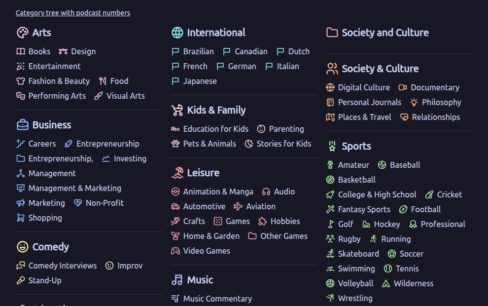

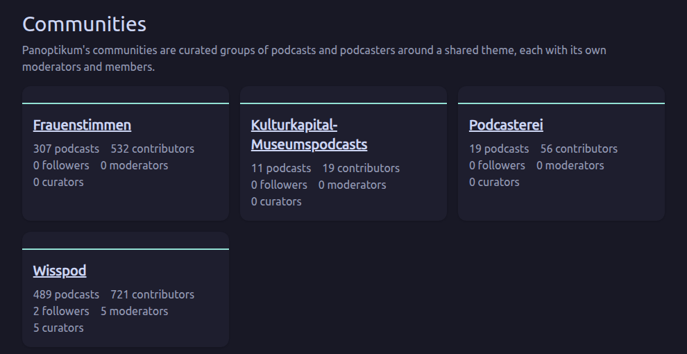

The button with the two arrows next to the Panoptikum logo folds the
sidebar in and out.

Search: Just enter one or more terms in the search field and
Panoptikum will show you the results in episodes, ordered by relevance.
The tabs above the results switch to podcasts, personas and categories.
[Example: personas with "Stefan" in the name](https://panoptikum.social/search/personas/Stefan)

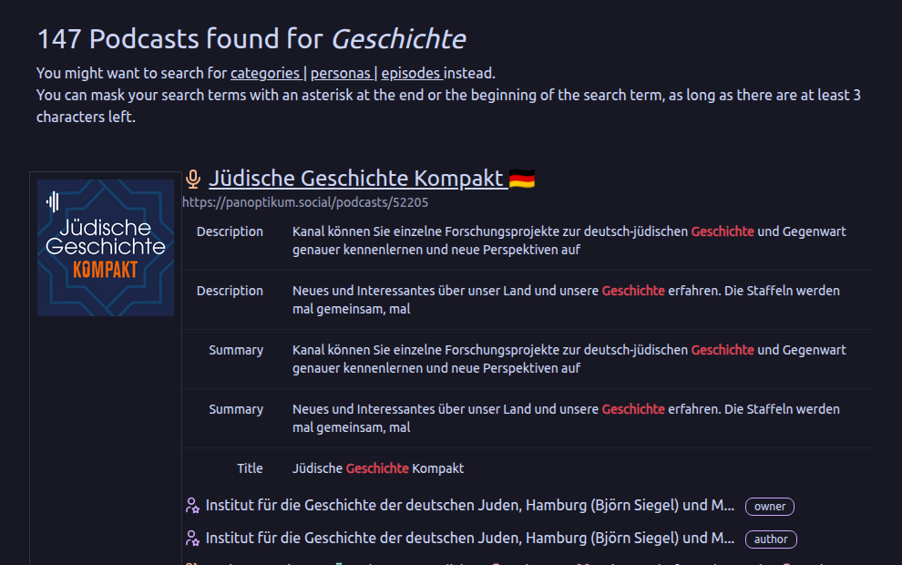

### Light and Dark Mode

The three buttons at the bottom of the sidebar choose how Panoptikum looks:
the sun for light, the moon for dark and the monitor in between to follow
the setting of your system, which is also the default. Your browser
remembers the choice.

### Language

The buttons EN and DE below choose the language of Panoptikum: English or
German. Without a choice, Panoptikum follows the language of your browser.
If you are logged in, the choice is stored in your account and applies on
all your devices. Content written by people – podcast and episode data,
recommendations, texts of communities – stays in its language.

### Listen to Episode

Panoptikum is using the
[Podlove Web Player](https://podlove.org/podlove-web-player/) on the
episode page. This offers you several functions for listening to a
podcast episode directly on the Panoptikum episode page:

Chapters: You can use the chapters for navigation directly in the web
player. The chapter you are listening to is marked.
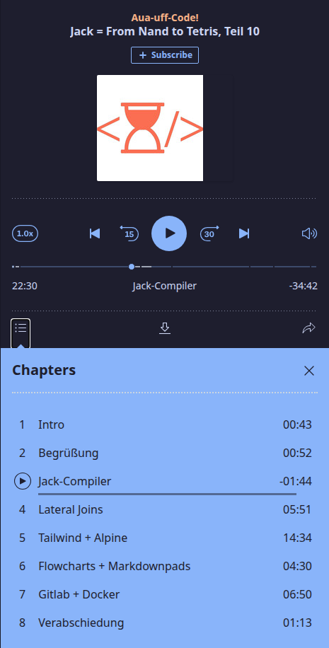
Speed and Volume: You can increase or decrease the speed (the button 1.0x
left of the controls) and adjust the volume (the speaker right of the
controls), see the picture above.

Share episode: You can share the complete episode
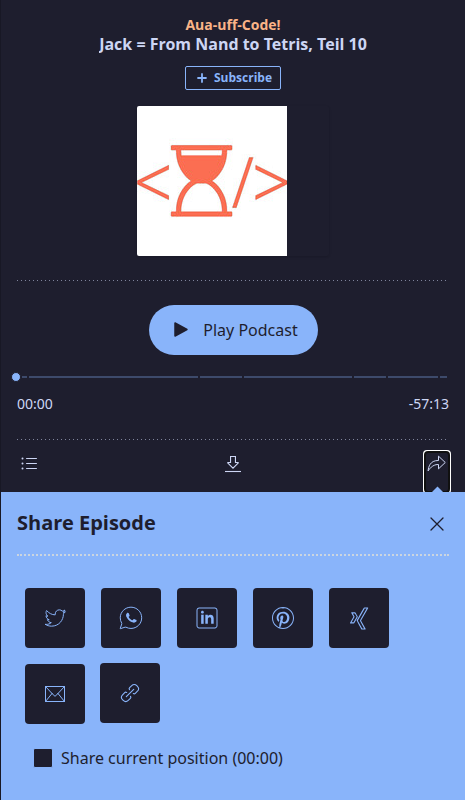
Share from a position: Tick "Share current position" to share the episode
from where you are listening right now.
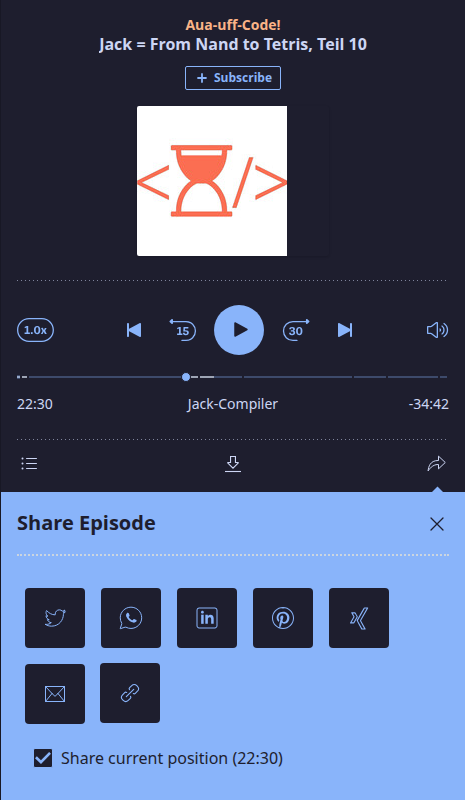
Files: You can download the audio file of the episode.
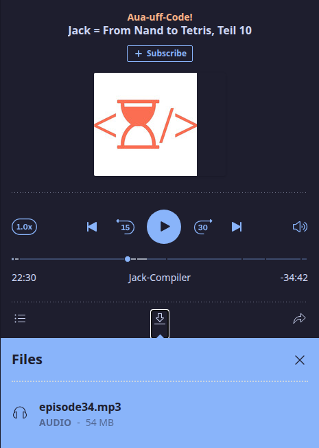

### Statistics

Panoptikum offers a great overview with its
[categories](https://panoptikum.social/categories) page. For those among
us who just love figures and want to know exactly how many podcasts
are in one category there are the hidden statistics. Try it out
[https://panoptikum.social/categories/stats](https://panoptikum.social/categories/stats).
The number of podcasts per category are added to the update view of
the categories page. It also works within the category. For example within
[https://panoptikum.social/categories/13/stats](https://panoptikum.social/categories/13/stats)
you can see how many podcasts are available per language. As the
podcasts have to be counted on the fly, building this page takes a
little more time. Please be patient!

## Registration

Panoptikum offers additional functionality after the log in:

* Recommendations and likes of podcasts and episodes
* Introduction to new podcasts based on current subscriptions and likes
* Suggesting a new podcast
* Uploading OPML files to suggest several podcasts at once

### Sign up

In the sidebar of every page you find a link to log
in. You can [Sign Up](https://panoptikum.social/users/new) on the log in
page and become a registered user.

You are asked for an email address (required for password recovery),
a user name (used for your reviews, comments and likes) and a password
(to log in). You can choose any user name as long as it has not been
taken yet within Panoptikum. The form also asks for your name, whether you
are a podcaster, and a small question that tells humans from bots.

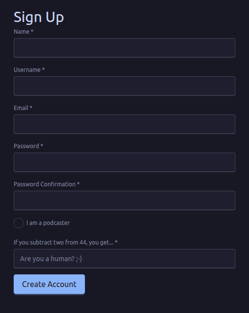

After **Create Account** Panoptikum sends you an email with a link to verify
your email address. You can log in once you have used that link.

Panoptikum tries to ask for (and save) only information, that is
required to offer the service. Besides the information provided during
registration, Panoptikum uses your uploaded subscription list (OPML
file) to add podcasts to the Panoptikum podcast database. It stores
and publishes that you are a subscriber of the podcast. Panoptikum
stores and publishes your reviews, comments and likes.

## Additional Functionality After Log In

In the sidebar of every page you find a link to
[Log In](https://panoptikum.social/sessions/new). After log in you see your
user name in the sidebar (in the example
below the user name is demo). Below your user name you find a menu with
the following functionalities:

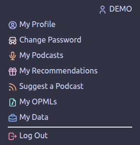

Moderators and curators of a community find two more entries there, **My
Moderations** and **My Curations**, see the
[Moderator Manual](/manuals/moderator-manual) and the
[Curator Manual](/manuals/curator-manual).

### My Profile

You can see and edit your data (name, username, email, podcaster y/n,
share followings y/n, share subscriptions y/n) and the languages you speak.

### Change Password

You can change your password.

### My Podcasts

You see information about you

* Subscriptions
* Podcasts I like
* Podcasts I follow

and get suggestions for new podcasts based on this information

* Listeners of the podcasts you listen to, also listen to
* Users, who like the same podcasts as you, also like
* The categories my podcasts are assigned to

Podcasters also find the podcasts they manage there, see the
[Podcaster Manual](/manuals/podcaster-manual).

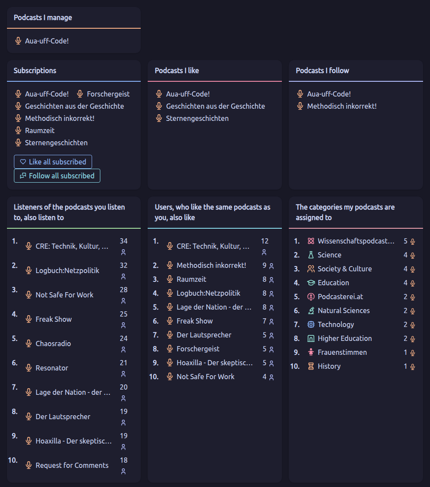

### My Recommendations

You see your podcast recommendations and can recommend subscribed
podcasts you didn't recommend yet.

### Suggest a Podcast

A podcast gets listed in Panoptikum when it is subscribed by at least
one of its registered users. If you want to add just one podcast, do
so with <kbd>Suggest a Podcast</kbd>.

You will be counted as a subscriber in the database. If you want to
suggest several or all the podcasts you listen to at once, you can
upload an OPML file with <kbd>My OPMLs</kbd> in your personal menu.

### My OPMLs

<kbd>My OPMLs</kbd> open the upload dialogue for the OPML file.
Your podcatcher (for example gPodder) can export the list of your
podcast subscriptions (gPodder: Abonnements - zu OPML-Datei
exportieren). This OPML-file is your subscription list that you can
upload to Panoptikum after log in. If you upload your subscription
list more than once, the latest upload amends the existing list.
With your upload of the file you support Panoptikum - the information
is needed for the listing of a podcast and the introduction
to new podcasts based on your current subscriptions and likes.

### My Data

<kbd>My Data</kbd> opens the page Account and offers all your data as a
JSON-File with a Download button and shows you all your stored data. You can
check what is stored the different areas and delete it per area. In the
area itself you can either delete all entries or just individual entries.

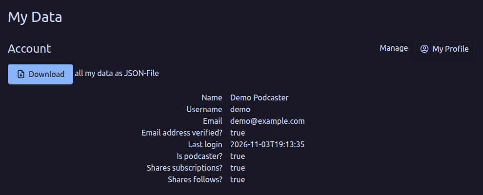

Areas and possibilities

* OPML File: list of uploaded files, manageable in My OPMLs
* Personas: overview to your personas
* Invoices: all your Panoptikum invoices with date and file
* Subscribed Podcasts: list of all your subscriptions (links to podcast show
  page)
* Followed Podcasts: list of all podcasts followed by you (links to podcast show
  page)
* Liked Podcasts: list of all podcasts liked by you (links to podcast show
  page)
* Liked Episodes: list of all podcast episodes liked by you (links to episode
  show page)
* Liked Chapters: list of all podcast episode chapters liked by you (links to
  episode show page)  
* Liked Users: list of all users liked by you (links to user show page)
* Followed Users: list of all users followed by you (links to user show page)
* Followed Personas: list of all personas followed by you (links to persona show
  page)
* Liked Personas: list of all personas liked by you (links to persona show page)   
* Followed Categories: list of all categories followed by you (links to category
  show page)
* Liked Categories: list of all categories liked by you (links to category
  show page)  
* Recommendations: list of all your recommendations with its text and the name
  of the recommended podcast or podcast episode

The page closes with the Danger Zone. You can directly delete your account there.
With <kbd>Delete my account</kbd> your account including all the stored data is
deleted.

Panoptikum can not restore your account after this action, but you can always
sign up for a new Panoptikum account.

## Recommendations and Likes

After log in you have additional possibilities on the different pages

* Podcast: recommend, like and follow
* Episode: recommend and like
* Chapters of an episode: recommend

On the page of a podcast the buttons show how many users like, follow and subscribe to the podcast; a click likes, follows or subscribes, or takes it back.


On the page of a podcast you write your recommendation into the field
"Your recommendation" and send it with <kbd>Recommend</kbd>.
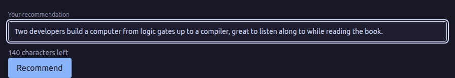

You have written a great recommendation of your favourite podcast and
want to spread the word outside Panoptikum?

Below your name, next to your recommendation in Panoptikum, wait two
buttons for you to tweet or email your recommendation.
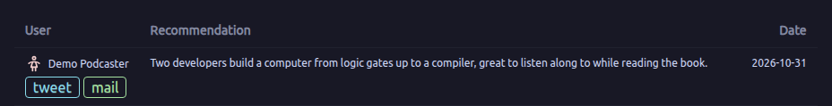

### Twitter

"tweet" opens X (Twitter) with your recommendation and the link to the
podcast as text, which you can edit before you post it.

### e-Mail

"mail" creates an email in your standard mail program. The subject
includes the podcast and your recommendation, the mail body the link to the
recommended podcast. You can edit both before send. For the recommendation
above it looks like this:

```
Subject: 👍 Aua-uff-Code!
         💬 Two developers build a computer from logic gates up to a compiler, great to listen along to while reading the book.
         🔊

https://panoptikum.social/podcasts/104
```
