+++
title = "Handbuch für Moderator:innen"
description = "Wie Sie eine Panoptikum-Community moderieren: ihre Podcasts, Feeds, API-Fehler, Kurator:innen und Pads."
menu = "main"
weight = 30
+++

(Es gibt auch ein [Handbuch für Hörer:innen](/manuals/listener-manual), ein [Handbuch für Podcaster:innen](/manuals/podcaster-manual) und ein [Handbuch für Kurator:innen](/manuals/curator-manual).)

Dieses Handbuch beschreibt Panoptikum aus Sicht der Moderator:innen. Lesen Sie bitte vorher das [Handbuch für Hörer:innen](/manuals/listener-manual) und das [Handbuch für Podcaster:innen](/manuals/podcaster-manual).

Die [Communitys](https://panoptikum.social/communities) von Panoptikum sind kuratierte Gruppen von Podcasts und Podcaster:innen zu einem gemeinsamen Thema, jede mit eigenen Moderator:innen und Mitgliedern. Jede Community hat eine eigene Kategorie: Die Podcasts dieser Kategorie sind die Podcasts der Community. Als Moderator:in kümmern Sie sich um sie.

Was Moderator:innen tun:

* Podcasts zu ihrer Community hinzufügen und wieder entfernen
* Daten von Podcasts, Episoden und Feeds korrigieren
* Die API-Fehler ihrer Community prüfen
* Kurator:innen zuweisen
* Die Kuratierungen ihrer Community lesen und Podcasts als erledigt markieren
* Die Pads ihrer Community anlegen und verwalten

Die Bilder zeigen einen Demo-Account, „Demo Podcaster“, als Moderator:in der Community Wisspod. Nur das Bild der Kurator:innen-Seite zeigt noch die englische Oberfläche.

## Moderator:in werden

Moderator:innen werden vom Panoptikum-Team ernannt. Wenn Sie eine Community moderieren möchten, schreiben Sie bitte an <sonja@panoptikum.social>.

Als Moderator:in finden Sie im Menü unter Ihrem Benutzernamen in der Seitenleiste zwei weitere Einträge: **Meine Moderationen** und **Meine Kuratierungen**.

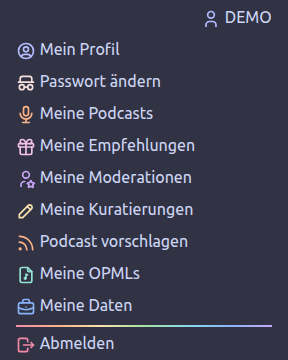

## Meine Moderationen

**Meine Moderationen** listet die Communitys, die Sie moderieren. Ein Klick auf eine Community öffnet ihre Moderationsseite.

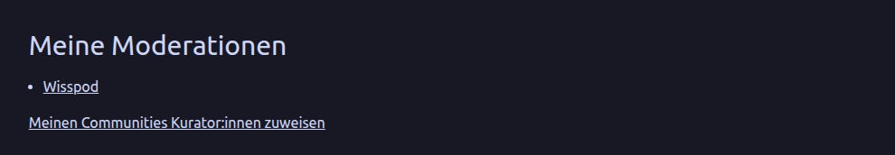

Die Pads einer Community können nur ihre Follower:innen sehen, bearbeiten und anlegen, auch Moderator:innen. Folgen Sie nicht allen Communitys, die Sie moderieren, listet ein Hinweis diese Communitys mit Links, damit Sie ihnen folgen können.

Unter der Liste finden Sie den Link **Meinen Communitys Kurator:innen zuweisen** (siehe „Kurator:innen“ unten).

## Die Moderationsseite

Die Moderationsseite hat die Überschrift „Moderation von“ mit dem Namen der Kategorie der Community, für die Community Wisspod „Moderation von Wissenschaftspodcasts.de“. Sie bietet den Link **API-Fehler der letzten 24 Stunden**, zwei Wege, Podcasts hinzuzufügen, und die Tabelle mit den Podcasts der Community.

### Podcasts hinzufügen

Es gibt zwei Wege, einen Podcast zu Ihrer Community hinzuzufügen:

* **Feed hinzufügen**: Fügen Sie die Adresse eines Podcast-Feeds in das erste Feld ein und klicken Sie auf **Feed hinzufügen**. Kennt Panoptikum den Feed noch nicht, importiert es den Podcast und fügt ihn Ihrer Community hinzu. Kennt es den Feed, fügt es den Podcast hinzu und aktualisiert ihn sofort aus dem Feed.
* **Suche**: Tippen Sie mindestens zwei Buchstaben eines Podcast-Titels in das zweite Feld. Panoptikum zeigt die passenden Podcasts, die es kennt. Klicken Sie neben dem gewünschten auf **➕ Hinzufügen**. Podcasts, die schon in Ihrer Community sind, sind mit „Schon in Ihrer Moderation“ markiert.

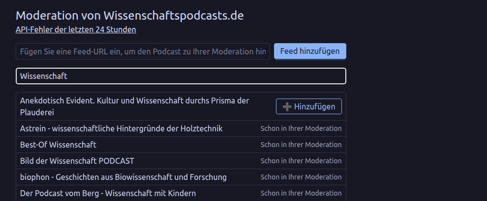

### Die Podcast-Tabelle

Die Tabelle „Podcasts“ zeigt die Podcasts Ihrer Community mit vielen Spalten, darunter die Zahl der Episoden, Follower:innen, Likes und Abonnements, ob Aktualisierungen pausiert sind, ob der Podcast stillgelegt ist, wie viele Aktualisierungen hintereinander fehlgeschlagen sind und die letzte Fehlermeldung. Sie können in der Tabelle suchen, sortieren und blättern.

Wählen Sie einen Podcast mit dem Kästchen am Anfang seiner Zeile aus und klicken Sie dann auf einen der Buttons:

* **🔍 Auf der Website zeigen**: öffnet die Seite des Podcasts auf Panoptikum.
* **✏️ Podcast bearbeiten**: öffnet das Formular, um die Daten des Podcasts zu korrigieren.
* **🔍 Liste der Episoden**: listet die Episoden des Podcasts.
* **🔍 Liste der Feeds**: listet die Feeds des Podcasts.
* **🗑️ Aus der Moderation entfernen**: entfernt den Podcast nach einer Rückfrage aus Ihrer Community. Der Podcast bleibt auf Panoptikum, er gehört nur nicht mehr zur Community.

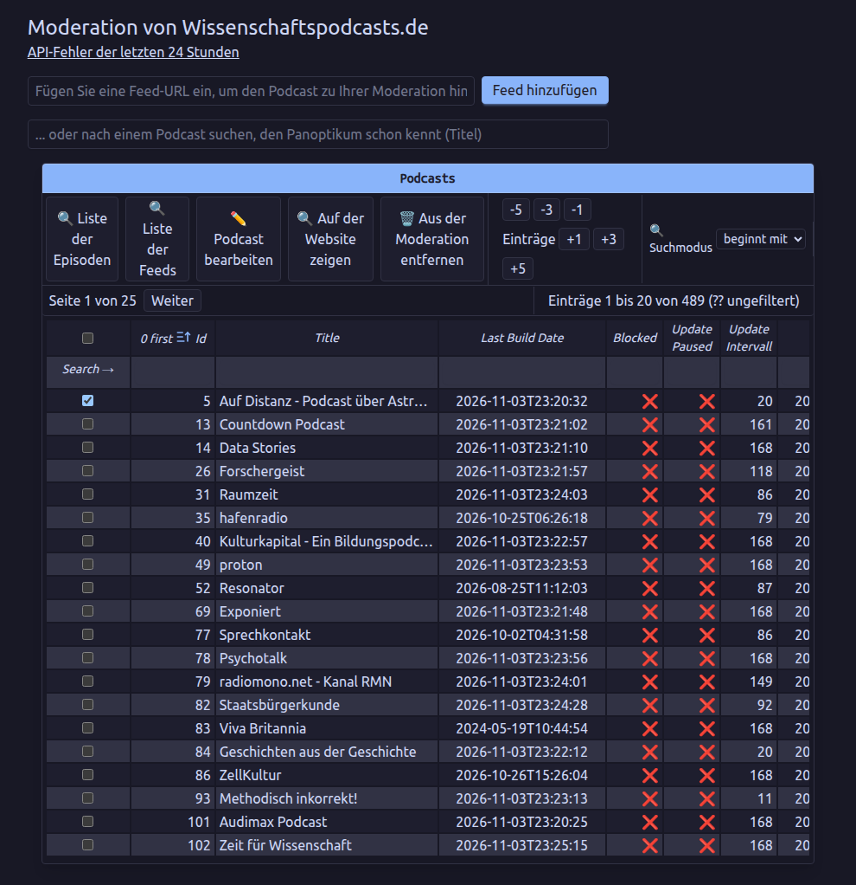

### Einen Podcast bearbeiten

Mit **✏️ Podcast bearbeiten** ändern Sie Titel, Website, Beschreibung, Zusammenfassung, Bildtitel, Bild-URL, Titel und URL des Zahlungslinks und die Angabe **Explizit**. Das Formular bietet außerdem drei Einstellungen für die Aktualisierungen:

* **Aktualisierung pausiert**: Panoptikum prüft den Feed nicht mehr auf Aktualisierungen.
* **Aktualisierungsintervall (Stunden)**: die Zahl der Stunden zwischen zwei Prüfungen des Feeds. Panoptikum passt sie selbst an: Nach jeder Prüfung ohne neue Episode kommt eine Stunde dazu (bis zu einer Woche), und bei einer neuen Episode geht es zurück auf 10 Stunden.
* **Stillgelegt**: Panoptikum prüft den Feed nicht mehr, meist weil er 10 Mal hintereinander nicht gelesen werden konnte.

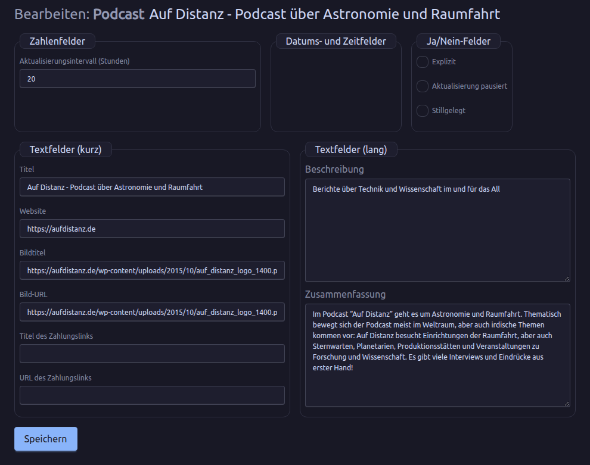

Bitte beachten Sie: Die meisten Daten eines Podcasts stammen aus seinem Feed. Die nächste Aktualisierung aus dem Feed überschreibt Ihre Änderungen. Um sie zu behalten, kreuzen Sie **Aktualisierung pausiert** an. Die regelmäßigen Aktualisierungen überspringen pausierte und stillgelegte Podcasts, aber „Metadaten aktualisieren“ auf der Seite des Podcasts nimmt die Aktualisierungen wieder auf und liest den Feed erneut. Wo es geht, bitten Sie lieber die Podcaster:in, den Feed zu korrigieren: Dann bleiben die Daten dauerhaft richtig.

### Eine Episode bearbeiten

**🔍 Liste der Episoden** zeigt die Episoden des ausgewählten Podcasts. Sie können darin suchen, eine mit **🔍 Auf der Website zeigen** öffnen oder mit **✏️ Episode bearbeiten** korrigieren: Titel, Link, Veröffentlichungsdatum, Beschreibung, Shownotes, Titel und URL des Zahlungslinks, Deeplink, Dauer, Untertitel, Zusammenfassung, Bildtitel und Bild-URL. Wie bei Podcasts überschreibt die nächste Aktualisierung aus dem Feed diese Änderungen.

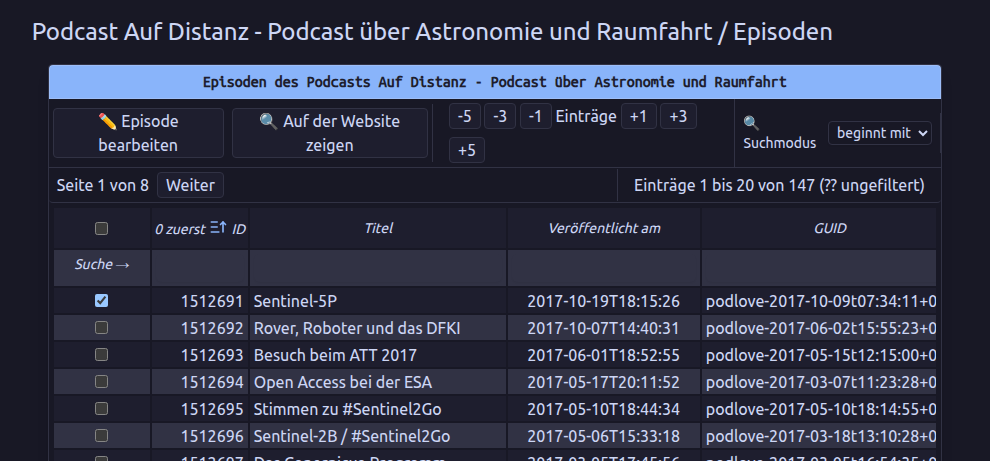

### Einen Feed bearbeiten

**🔍 Liste der Feeds** zeigt die Feeds des ausgewählten Podcasts. Mit **✏️ Feed bearbeiten** ändern Sie die Adresse des Feeds (**Feed-URL**) und seinen Titel (**Feed-Titel**), zum Beispiel wenn ein Podcast umgezogen ist und sein alter Hoster nicht weiterleitet.

Hatte der Feed früher andere Adressen, bietet **Eine frühere URL wiederherstellen** sie mit dem Datum an, an dem Panoptikum sie vermerkt hat. Wählen Sie eine aus und klicken Sie auf **Wiederherstellen**; Panoptikum fragt nach, bevor es sie wieder zur Feed-Adresse macht.

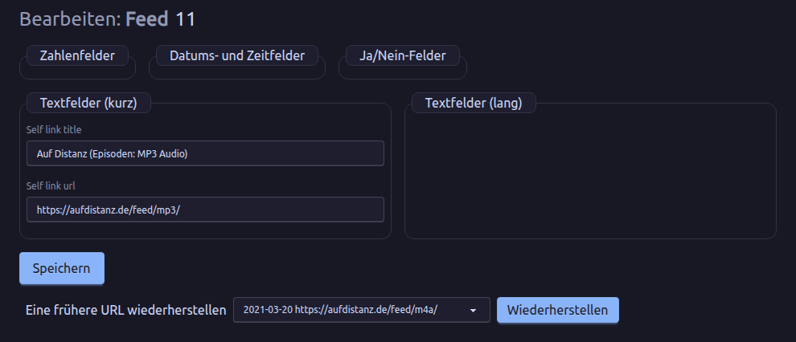

## API-Fehler

Manche Communitys betreiben eine eigene Website mit den Podcasts der Community und lesen die Daten über die [API](/api) von Panoptikum. Schlägt eine solche Anfrage fehl, vermerkt Panoptikum das. Der Link **API-Fehler der letzten 24 Stunden** auf der Moderationsseite zeigt diese fehlgeschlagenen Anfragen zu Podcasts Ihrer Community und zu Podcasts, die es nicht mehr gibt, eine Zeile pro Podcast mit dem letzten Fehler. Die Zeiten sind Wiener Zeit; **Neu laden** zeigt den neuesten Stand.

Die Spalten:

* **Podcast**: der Titel des Podcasts, verlinkt mit seinem Bearbeitungsformular, mit seiner Panoptikum-ID. Ein Podcast, den es nicht mehr gibt, zeigt seinen früheren Titel kursiv oder „gibt es nicht mehr“. Wurde er mit einem anderen Podcast zusammengeführt, nennt die Fehlermeldung die ID dieses Podcasts, damit Ihre Website die neue ID verwenden kann.
* **Feed reparieren** öffnet das Bearbeitungsformular des Feeds in einem neuen Tab. **Aus der Community entfernen** entfernt den Podcast nach einer Rückfrage aus Ihrer Community; der Podcast bleibt auf Panoptikum.
* **Fehler**: was schiefgegangen ist, zum Beispiel „Feed download failed“ mit dem Grund. Die Fehlermeldungen kommen von der API und sind englisch.
* **Status**, **Fehlgeschlagen** (wie oft in den letzten 24 Stunden) und **Letzter Fehler**.
* **Endpunkte**: welche Anfragen fehlgeschlagen sind. „show“ liest die Daten des Podcasts, „trigger_episode_update“ bittet Panoptikum, neue Episoden zu holen.

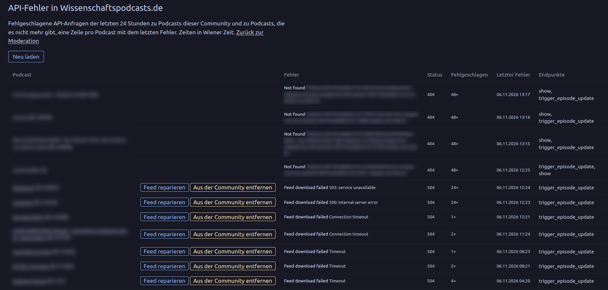

## Kurator:innen

Kurator:innen bewerten die Podcasts einer Community, siehe das [Handbuch für Kurator:innen](/manuals/curator-manual). Der Link **Meinen Communitys Kurator:innen zuweisen** unter **Meine Moderationen** öffnet die Seite „Kurator:innen meiner Communitys“. Sie listet jede Community, die Sie moderieren, mit ihren Kurator:innen.

* **Zuweisen**: Wählen Sie eine Benutzer:in, die schon Kurator:in ist, und weisen Sie sie der Community zu.
* **Zur Kurator:in machen und zuweisen**: Geben Sie den genauen Benutzernamen einer beliebigen Panoptikum-Benutzer:in ein. Damit wird sie in einem Schritt zur Kurator:in und der Community zugewiesen.
* **Entfernen** neben einer Kurator:in entfernt sie nach einer Rückfrage aus der Community. Ihre Kuratierungen bleiben erhalten. Die Kurator:innen-Rolle ganz entziehen können nur Admins.

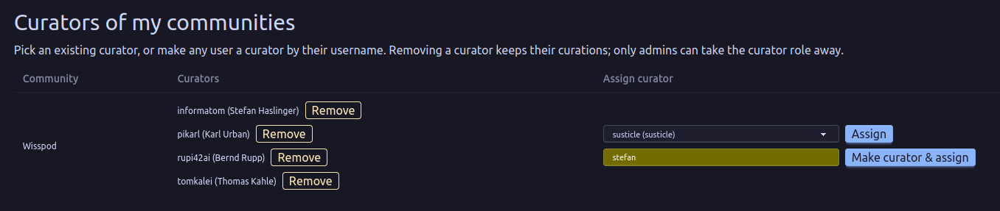

## Kuratierungen

Als Moderator:in können Sie unter **Meine Kuratierungen** alle Kuratierungen Ihrer Communitys lesen, auch wenn Sie selbst keine Kurator:in sind. Außerdem entscheiden Sie, welche Podcasts noch zur Kuratierung offen sind: In der Übersicht einer Community können Sie nach „offen zur Kuratierung“, „erledigt“ und „alle“ filtern und einen Podcast als erledigt markieren oder wieder öffnen. Das [Handbuch für Kurator:innen](/manuals/curator-manual) beschreibt diese Seiten.

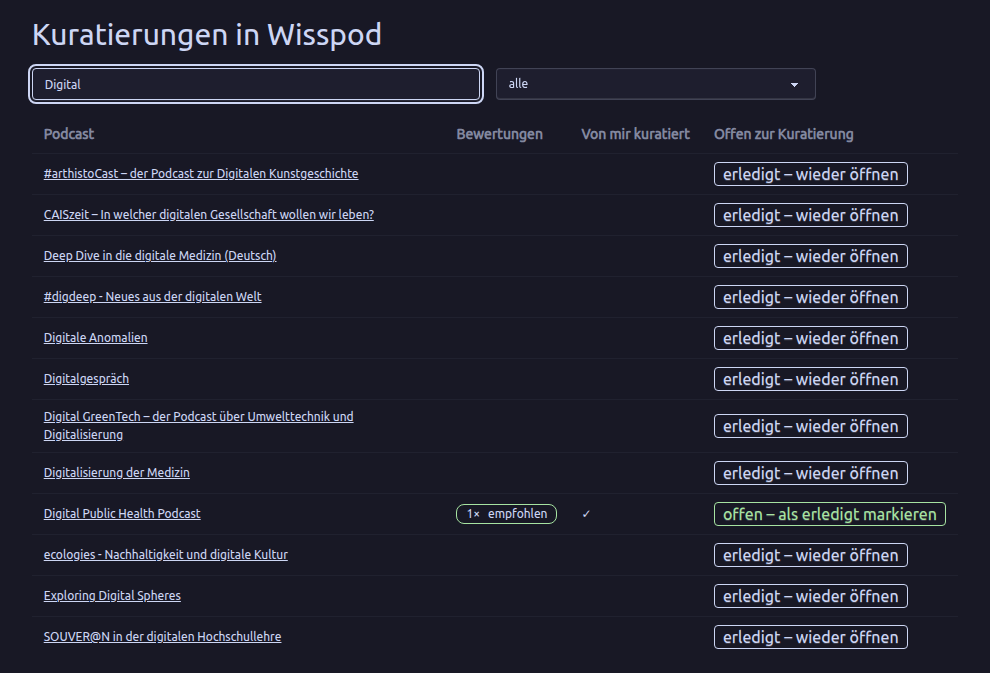

Um selbst Kuratierungen zu schreiben, weisen Sie sich als Kurator:in der Community zu.

## Pads

Pads sind Markdown-Dokumente, die die Follower:innen einer Community gemeinsam schreiben, auf der Seite der Community. Nur Follower:innen sehen sie. Als Moderator:in, die der Community folgt, können Sie sie außerdem verwalten:

* **Neues Pad**: Geben Sie auf der Seite der Community einen Titel ein und klicken Sie auf **Neues Pad**. Der Titel muss in der Community eindeutig sein.

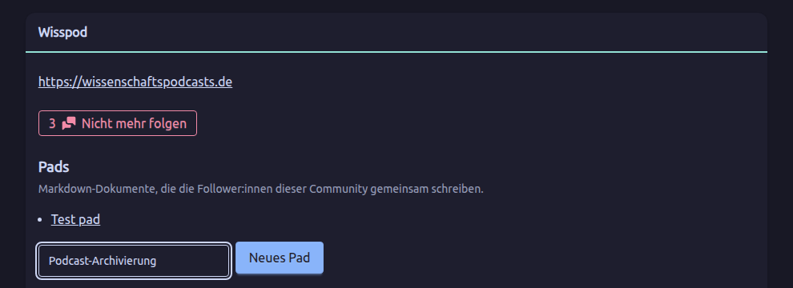

* **Dieses Pad verwalten**, auf der Seite des Pads:
  * **Schreibschutz setzen** friert das Pad für alle ein, auch für Moderator:innen. **Bearbeitbar machen** hebt das wieder auf.
  * **Umbenennen** ändert den Titel. Damit ändert sich auch die Adresse des Pads, alte Links funktionieren dann nicht mehr.
  * **Pad löschen** entfernt das Pad und alle seine gespeicherten Versionen, nach einer Rückfrage.

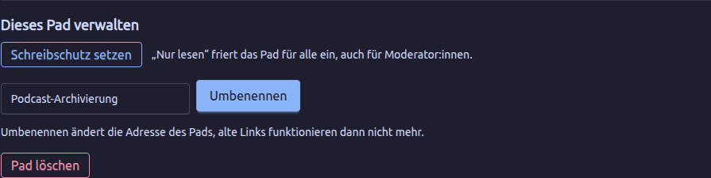

Die Moderation allein gibt keinen Zugang zu den Pads: Folgen Sie der Community, um mit ihnen zu arbeiten.
