+++
title = "Moderator Manual"
description = "How to moderate a Panoptikum community: its podcasts, feeds, API errors, curators and pads."
menu = "main"
weight = 30
+++

(There are also a [Listener Manual](/manuals/listener-manual), a [Podcaster Manual](/manuals/podcaster-manual) and a [Curator Manual](/manuals/curator-manual).)

This manual describes the use of Panoptikum from the moderator perspective. Please read the [Listener Manual](/manuals/listener-manual) and the [Podcaster Manual](/manuals/podcaster-manual) before this one.

Panoptikum's [communities](https://panoptikum.social/communities) are curated groups of podcasts and podcasters around a shared theme, each with its own moderators and members. Every community has a category of its own: the podcasts in this category are the podcasts of the community. As a moderator you look after them.

What moderators do:

* Add podcasts to their community and remove them again
* Correct podcast, episode and feed data
* Check the API errors of their community
* Assign curators
* Read the curations of their community and mark podcasts as done
* Create and manage the pads of their community

The pictures show a demo user, "Demo Podcaster", as moderator of the community Wisspod.

## Becoming a Moderator

Moderators are appointed by the Panoptikum team. If you would like to moderate a community, please send an email to <sonja@panoptikum.social>.

As a moderator you find two more entries in the menu below your user name in the sidebar: **My Moderations** and **My Curations**.

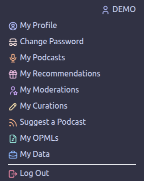

## My Moderations

**My Moderations** lists the communities you moderate. A click on a community opens its moderation page.

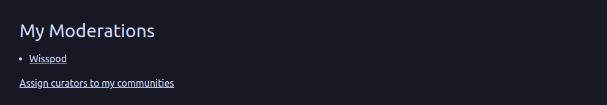

Pads of a community can only be seen, edited and created by its followers, moderators included. If you don't follow every community you moderate, a notice lists those communities with links, so you can follow them.

Below the list you find the link **Assign curators to my communities** (see "Curators" below).

## The Moderation Page

The moderation page has the heading "Moderating" and the name of the community's category, for the community Wisspod "Moderating Wissenschaftspodcasts.de". It offers the link **API errors of the last 24 hours**, two ways to add podcasts and the table of the community's podcasts.

### Adding Podcasts

There are two ways to add a podcast to your community:

* **Add feed**: Paste the address of a podcast feed into the first field and use **Add feed**. If Panoptikum doesn't know the feed yet, it imports the podcast and adds it to your community. If it knows the feed, it adds the podcast and updates it from the feed right away.
* **Search**: Type at least two letters of a podcast title into the second field. Panoptikum shows the matching podcasts it knows. Use **➕ Add** next to the one you want. Podcasts that are already in your community are marked "Already in your moderation".

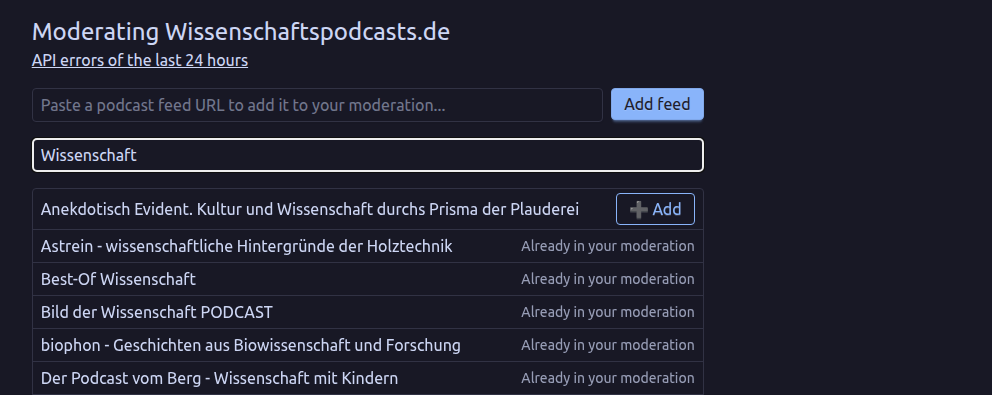

### The Podcast Table

The table "Listing Podcasts" shows the podcasts of your community with many columns, among them the number of episodes, followers, likes and subscriptions, whether updates are paused, whether the podcast is retired, how many updates failed in a row and the last error message. You can search, sort and page through the table.

Select a podcast in the table with the box at the start of its row, then use one of the buttons:

* **🔍 Show in Frontend**: opens the podcast's page on Panoptikum.
* **✏️ Edit Podcast**: opens the form to correct the podcast's data.
* **🔍 List of Episodes**: lists the episodes of the podcast.
* **🔍 List of Feeds**: lists the feeds of the podcast.
* **🗑️ Remove from Moderation**: removes the podcast from your community, after you have confirmed it. The podcast stays on Panoptikum, it just doesn't belong to the community any more.

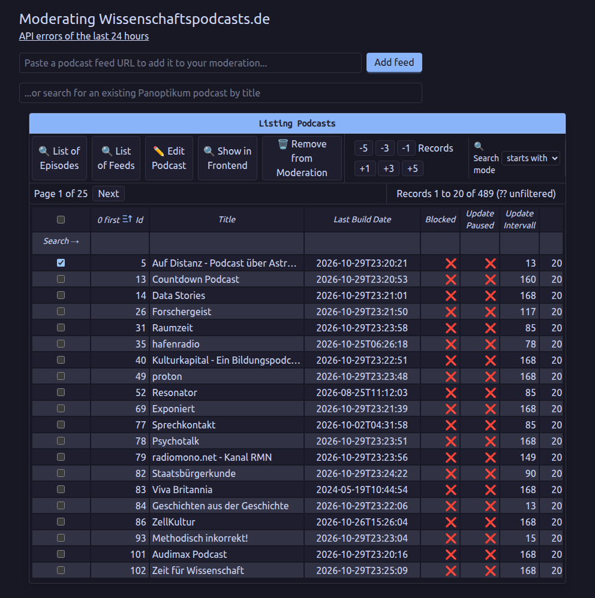

### Editing a Podcast

**✏️ Edit Podcast** lets you change the title, website, description, summary, image title, image URL, payment link title and URL, and explicit. It also offers three settings for the updates:

* **Update paused**: Panoptikum doesn't check the feed for updates any more.
* **Update intervall**: the number of hours between two checks of the feed. Panoptikum adjusts it by itself: it adds an hour after every check without a new episode (up to a week) and goes back to 10 hours when a new episode turns up.
* **Retired**: Panoptikum doesn't check the feed any more, usually because it couldn't be read for 10 times in a row.

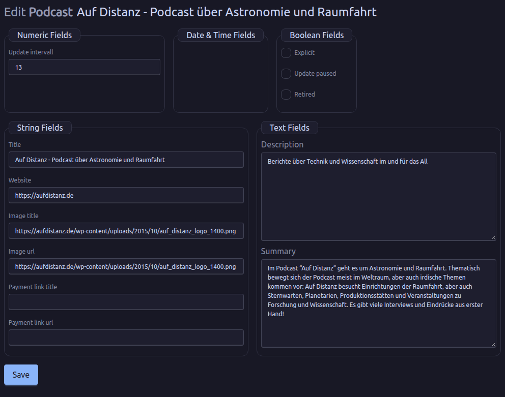

Please note: Most of the podcast's data comes from its feed. The next update from the feed overwrites your changes. To keep them, tick **Update paused**. The regular updates skip paused and retired podcasts, but a "Metadata Update" on the podcast page resumes the updates and reads the feed again. Where you can, ask the podcaster to fix the feed instead: then the data stays right for good.

### Editing an Episode

**🔍 List of Episodes** shows the episodes of the selected podcast. You can search them, open one with **🔍 Show in Frontend** or correct it with **✏️ Edit Episode**: title, link, publishing date, description, shownotes, payment link title and URL, deep link, duration, subtitle, summary, image title and image URL. As with podcasts, the next update from the feed overwrites these changes.

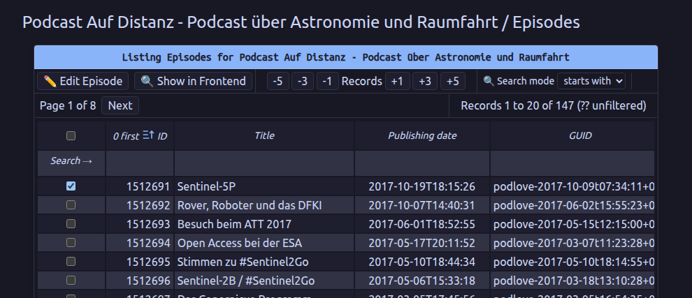

### Editing a Feed

**🔍 List of Feeds** shows the feeds of the selected podcast. **✏️ Edit Feed** lets you change the feed's address (self link URL) and its title, for example when a podcast moved and its old hoster doesn't redirect.

If the feed had other addresses before, **Restore a previous URL** offers them with the date Panoptikum noted them. Choose one and use **Restore**; Panoptikum asks before it makes it the feed address again.

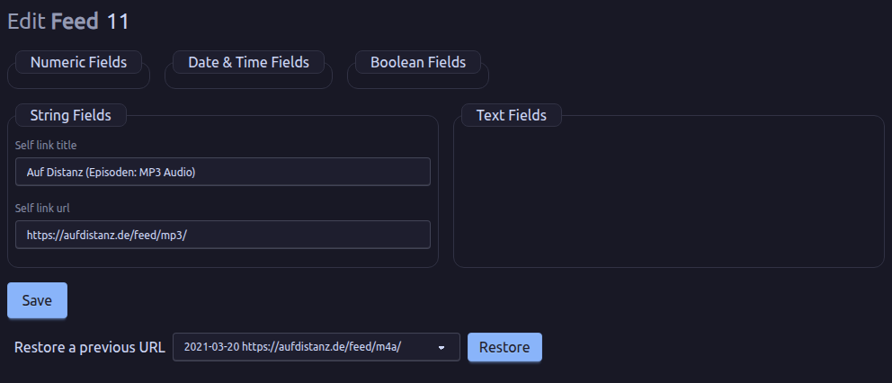

## API Errors

Some communities run their own website with the podcasts of the community and read the data from the Panoptikum [API](/api). When such a request fails, Panoptikum notes it. The link **API errors of the last 24 hours** on the moderation page shows these failed requests on the podcasts of your community and on podcasts that no longer exist, one row per podcast with its latest error. Times are Vienna time; **Reload** shows the newest state.

The columns:

* **Podcast**: the podcast's title, linked to its edit form, with its Panoptikum ID. A podcast that no longer exists shows its former title in italics, or "no longer exists". If it was merged into another podcast, the error message names the ID of that podcast, so your website can use the new ID.
* **Fix feed** opens the feed's edit form in a new tab. **Remove from community** removes the podcast from your community, after you have confirmed it; the podcast stays on Panoptikum.
* **Error**: what went wrong, for example "Feed download failed" with the reason.
* **Status**, **Failed** (how often in the last 24 hours) and **Last failure**.
* **Endpoints**: which requests failed. "show" reads the podcast's data, "trigger_episode_update" asks Panoptikum to fetch new episodes.

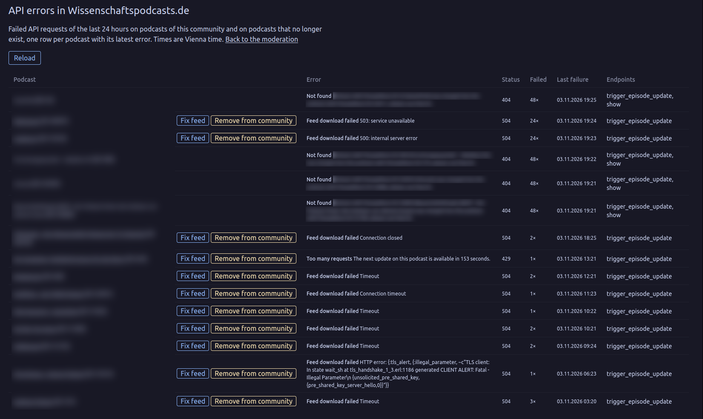

## Curators

Curators assess the podcasts of a community, see the [Curator Manual](/manuals/curator-manual). The link **Assign curators to my communities** on **My Moderations** opens the page "Curators of my communities". It lists every community you moderate with its curators.

* **Assign**: pick a user who is a curator already and assign them to the community.
* **Make curator & assign**: enter the exact username of any Panoptikum user. This makes them a curator and assigns them to the community in one step.
* **Remove** next to a curator removes them from the community, after you have confirmed it. Their curations stay. Only admins can take the curator role away completely.

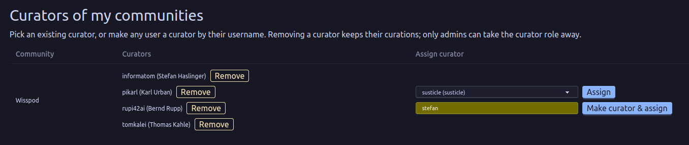

## Curations

As a moderator you can read all curations of your communities under **My Curations**, even if you aren't a curator yourself. You also decide which podcasts are still open for curation: in the overview of a community you can filter by "open for curation", "done" and "all", and mark a podcast as done or reopen it. The [Curator Manual](/manuals/curator-manual) describes these pages.

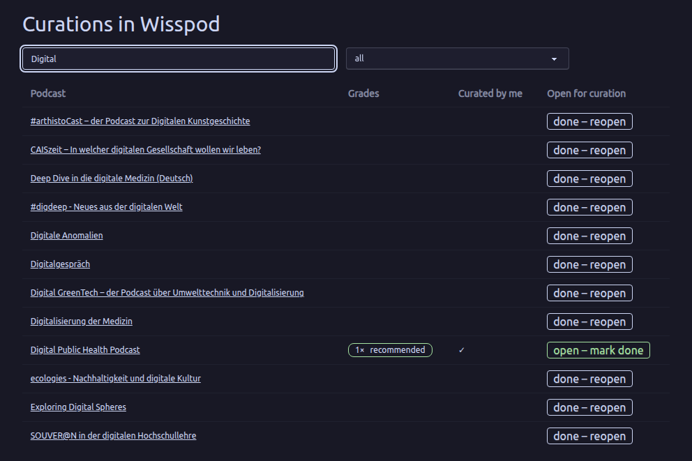

To write curations yourself, assign yourself as a curator of the community.

## Pads

Pads are Markdown documents that the followers of a community write together, on the community's page. Only followers see them. As a moderator who follows the community you can also manage them:

* **New pad**: on the community's page, enter a title and use **New pad**. The title has to be unique within the community.

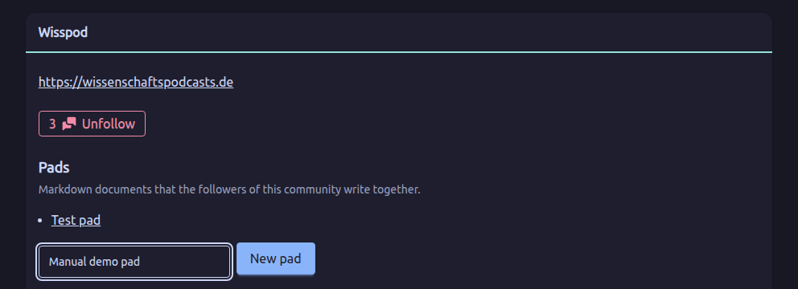

* **Manage this pad**, on the pad's page:
  * **Make read only** freezes the pad for everybody, moderators included. **Make editable** unfreezes it.
  * **Rename** changes the title. It also changes the pad's address, so old links stop working.
  * **Delete pad** removes the pad and all its saved versions, after you have confirmed it.

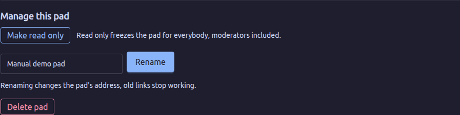

Moderating alone gives no access to the pads: follow the community to work with them.
