+++
title = "Handbuch für Podcaster:innen"
description = "Wie Sie Panoptikum als Podcaster:in nutzen: Listung, Personas, API und mehr."
menu = "main"
weight = 20
+++

(Es gibt auch ein [Handbuch für Hörer:innen](/manuals/listener-manual), ein [Handbuch für Moderator:innen](/manuals/moderator-manual) und ein [Handbuch für Kurator:innen](/manuals/curator-manual), siehe die [Übersicht aller Handbücher](/manuals).)

Dieses [Handbuch für Podcaster:innen](/manuals/podcaster-manual) beschreibt Panoptikum aus Sicht der Podcaster:innen. Lesen Sie bitte vorher das [Handbuch für Hörer:innen](/manuals/listener-manual). Panoptikum erkennt Mitwirkende anhand der Metadaten in den RSS-Feeds und zeigt Informationen über diese Personen. Podcaster:innen können ihre automatisch erstellten Visitenkarten kostenlos ergänzen und verwalten.

Die Bilder zeigen noch die englische Oberfläche.

## Funktionen unabhängig von einer Registrierung

Grundfunktionen für Podcaster:innen:

* Listung des Podcasts auf Panoptikum in den Kategorien, die im Feed angegeben sind
* Episodenliste mit Shownotes und eingebautem Player auf der Detailseite jeder Episode
* Einfaches Abonnieren des Podcasts über den Abonnieren-Button oder einen QR-Code
* Empfehlungen
* API zum Abrufen von Daten
* Personas

Panoptikum zeigt Statistiken zu Podcasts direkt auf der Seite. Über die API können Podcaster:innen Daten für eigene Anwendungen oder Websites abrufen. Informationen zu einzelnen Hörer:innen (außer Ihnen selbst) gibt die API nicht heraus.

### Listung meines Podcasts

Ihr Podcast wird auf Panoptikum gelistet, wenn er in mindestens einer hochgeladenen OPML-Datei einer registrierten Benutzer:in vorkommt. Sie können Ihren Podcast nach der Registrierung auch selbst hinzufügen. Registrierte Benutzer:innen nutzen dafür die Funktion „Podcast vorschlagen“ im Menü unter ihrem Benutzernamen. Mehr zur Registrierung und zur Listung von Podcasts steht im [Handbuch für Hörer:innen](/manuals/listener-manual).

Wenn Sie Ihren Podcast von Panoptikum entfernen möchten, schicken Sie bitte eine E-Mail an <sonja@panoptikum.social>. Eine Begründung ist nicht nötig. Das wird von Hand erledigt.

Nach 10 fehlgeschlagenen Versuchen prüft Panoptikum einen Podcast nicht mehr auf Aktualisierungen. Sie können den Zähler (nach der Anmeldung) mit einem erfolgreichen „Metadaten aktualisieren“ zurücksetzen (mehr dazu im Abschnitt „Metadaten aktualisieren“).

### Besser gefunden und leichter abonniert

Durch die Listung auf Panoptikum kann Ihr Podcast von Hörer:innen entdeckt werden: über Empfehlungen, Kategorien und die Suche. Mit der Episodenliste samt Shownotes bekommen Interessierte einen guten Überblick über Ihren Podcast und seine Inhalte. Der eingebaute Player ist der schnellste Weg, in den Podcast hineinzuhören und zu spüren, ob man auf derselben Wellenlänge ist.

Aus Interessierten werden ganz einfach regelmäßige Hörer:innen: über den Abonnieren-Button oder den QR-Code auf der Seite Ihres Podcasts auf Panoptikum.

Kopieren Sie den QR-Code zum Abonnieren IHRES Podcasts! Der QR-Code auf der Seite Ihres Podcasts auf Panoptikum macht es nicht nur Interessierten leichter, Ihren Podcast zu abonnieren. Sie können ihn auch selbst verwenden! Kopieren Sie das QR-Bild einfach auf Ihre eigene Website, auf Sticker oder Visitenkarten. Womit auch immer Sie auf Ihren Podcast aufmerksam machen: Das Abo ist nur einen Scan entfernt.

### Empfehlungen

Für Ihre Hörer:innen, die Ihren Podcast gerne empfehlen möchten, aber auf ihre Privatsphäre achten und dafür nicht die großen Plattformen nutzen wollen, bietet Panoptikum die Empfehlungsfunktion.

Panoptikum ist ein Projekt, das die Privatsphäre seiner Benutzer:innen respektiert. Mehr dazu in unserer [Datenschutzerklärung](/privacy).

### API

Panoptikum bietet eine API für andere Anwendungen. So können Sie Daten für Ihr eigenes Projekt oder Ihre Website abrufen. Die API folgt dem Standard [json:api](https://jsonapi.org/). Podcasts einer Kategorie, Gigs einer Persona und Episoden eines Podcasts werden seitenweise geliefert.

Die Endpunkte sind ohne Drosselung verfügbar, mit einer Ausnahme: Die Aktualisierung eines Podcasts (`trigger_update` und `trigger_episode_update`) lässt sich einmal alle 5 Minuten pro Podcast anfordern. Eine frühere Anfrage bekommt den Status 429 („Too many requests“) mit der Zahl der Sekunden bis zur nächsten möglichen Aktualisierung.

Mit der Volltextsuche kann Ihr Programm in Kategorien, Podcasts, Episoden und Personas suchen.

Beispiele
* [https://panoptikum.social/jsonapi/search?filter[persona]=Sonja](https://panoptikum.social/jsonapi/search?filter[persona]=Sonja), um alle Personas mit dem Namen Sonja zu finden
* [https://panoptikum.social/jsonapi/search?filter[episode]=coding](https://panoptikum.social/jsonapi/search?filter[episode]=coding), um Episoden mit dem Begriff „coding“ in Titel, Beschreibung, Shownotes usw. zu finden
* [https://panoptikum.social/jsonapi/podcasts/most_liked](https://panoptikum.social/jsonapi/podcasts/most_liked)
  für die Top 10 der beliebtesten Podcasts, absteigend nach Zahl der Likes.
* [https://panoptikum.social/jsonapi/podcasts/most_subscribed](https://panoptikum.social/jsonapi/podcasts/most_subscribed)
  für die Top 10 der meistabonnierten Podcasts, absteigend nach Zahl der Abonnements.
* [https://panoptikum.social/jsonapi/podcasts/last_updated](https://panoptikum.social/jsonapi/podcasts/last_updated)
  für die zuletzt aktualisierten Podcasts (seitenweise – Sie bestimmen die Anzahl, Standard ist 10).

Details stehen in der [API-Dokumentation](/api) (auf Englisch).

### Personas

Im Panoptikum-Universum kann jede Person verschiedene Rollen haben. Da ist die registrierte Benutzer:in, die sich mit Benutzername und Passwort anmeldet. Dann ist da die Podcaster:in, also eine Person, die Podcasts macht. Podcaster:in wird man, indem man einen Podcast besitzt oder an einem mitwirkt. Aber was ist mit Firmen, die Podcasts haben, oder mit mehreren Leuten, die einen Podcast gemeinsam machen? Dafür gibt es Personas.

Aus den Mitwirkenden von Podcasts werden automatisch Personas angelegt. Sie sind unter dem Menüpunkt [Podcaster:innen](https://panoptikum.social/personas) gelistet.
Nutzen Sie die Suche auf der [Seite der Personas](https://panoptikum.social/personas), um Ihre Persona(s) zu finden. Die Suchergebnisse werden mit jedem Tastendruck aktualisiert, während Sie den Suchbegriff eingeben. Oft müssen Sie gar nicht den ganzen Begriff eingeben, um Ihre Persona zu finden.

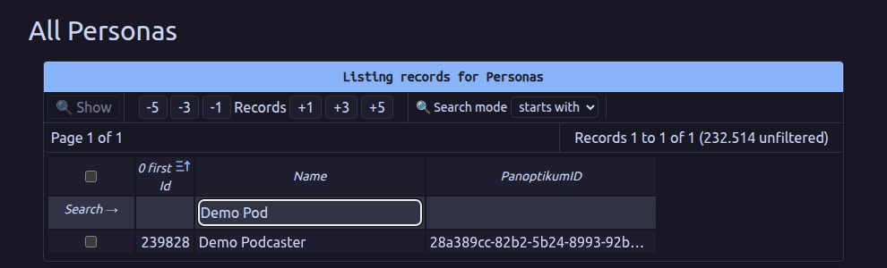

Zwei Beispiele:
* Mathilda hört Podcasts. Sie ist keine Podcasterin und hat keine Persona.
* Stefan hört Podcasts und ist Podcaster. Er macht gemeinsam mit Matthias den Podcast
[Aua-uff-code!](https://panoptikum.social/podcasts/104), hat zum Beispiel bei
[Zeitsprung #64](https://panoptikum.social/episodes/40276) mitgewirkt, war im
[IT-Keller](https://panoptikum.social/podcasts/495) zu Gast, hat regelmäßig beim
[Biertaucher](https://panoptikum.social/podcasts/119) mitgeredet und so weiter. Er ist eindeutig Podcaster
(abgeleitet aus den Eigentümerangaben im Feed von
[Aua-uff-code!](https://panoptikum.social/podcasts/104)) und hat eine Persona Informatom, auf der er alle seine Projekte zeigen kann.

## Funktionen für registrierte Podcaster:innen

Bei der Registrierung und später in Ihrem Profil können Sie angeben, ob Sie Podcaster:in sind (Kästchen „Ich bin Podcaster:in“).

Vorteile für registrierte Podcaster:innen:

* Ihren eigenen Podcast vorschlagen
* Empfehlungen schreiben
* Die Verwaltung Ihres Podcasts beantragen und seinen Feed prüfen
* Personas übernehmen
* Ihre Persona-Seite bearbeiten (URL, Bild, Beschreibung)
* Personas weiterleiten und delegieren

Aus den Mitwirkenden von Podcasts werden automatisch Personas angelegt. Sie sind auf Panoptikum unter [Podcaster:innen](https://panoptikum.social/personas) gelistet.

### Die Verwaltung Ihres Podcasts beantragen

Ein Podcast auf Panoptikum kann von einer registrierten Benutzer:in verwaltet werden. Wer Ihren Podcast verwaltet, kann seinen Feed prüfen (siehe „Ihren Feed prüfen“ unten). Ihre Podcasts stehen unter **Podcasts, die ich verwalte** auf der Seite **Meine Podcasts**. Dafür brauchen Sie eine bestätigte E-Mail-Adresse.

Es gibt zwei Wege dorthin:

* Automatisch: Wenn Sie **Meine Podcasts** öffnen, ordnet Panoptikum Ihnen alle Podcasts zu, die noch niemand verwaltet und deren Feed Ihre E-Mail-Adresse als Adresse der Eigentümer:in nennt (zum Beispiel in `itunes:owner`).
* Mit **Verwaltung beantragen** auf der Seite Ihres Podcasts, wenn ihn noch niemand verwaltet: Panoptikum schickt einen Bestätigungslink an die Eigentümer:innen-Adresse aus dem Feed. Wer die E-Mails dieser Adresse liest, öffnet den Link und bestätigt; dann verwalten Sie den Podcast. Der Link ist 48 Stunden gültig.

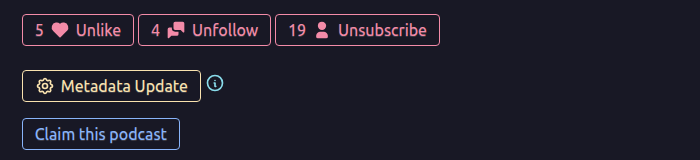

Nennt der Feed keine Eigentümer:innen-Adresse, kann Panoptikum keine Bestätigung schicken. Verwaltet versehentlich jemand anderes Ihren Podcast, schreiben Sie bitte an <sonja@panoptikum.social>.

### Ihren Feed prüfen

**Feed prüfen** auf der Seite Ihres Podcasts zeigt einen Bericht über Ihren Feed. Er steht der Person zur Verfügung, die den Podcast verwaltet, den Moderator:innen und dem Panoptikum-Team. Panoptikum lädt für jede Prüfung eine frische Kopie des Feeds herunter, so können Sie Ihren Feed korrigieren und mit **Erneut prüfen** das Ergebnis sehen.

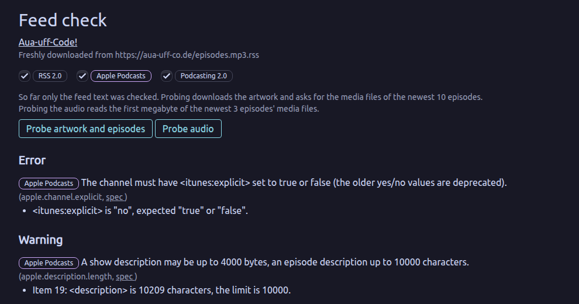

Der Bericht prüft den Feed nach den Regelwerken von RSS 2.0, Apple Podcasts und Podcasting 2.0, jeweils mit Fehlern, Warnungen und Hinweisen, einem Link zur Regel und der Stelle in Ihrem Feed. Die Regeltexte selbst sind englisch. Mit den Kästchen oben schalten Sie die Regelwerke ein und aus. Weitere Abschnitte zeigen, was Panoptikum aus Ihrem Feed trotzdem liest, obwohl es nicht dem Standard entspricht (andere Apps vielleicht nicht), und was Panoptikum überhaupt aus Ihrem Feed liest: Titel, Artwork, Eigentümer:in, Kategorien, Personen, Episoden und mehr.

Zwei Buttons prüfen mehr als den Feed selbst:

* **Artwork und Episoden prüfen** lädt das Artwork herunter und fragt die Audiodateien der 10 neuesten Episoden ab, zum Beispiel ob das Artwork die richtige Größe hat und ob die Audiodateien erreichbar sind.
* **Audio prüfen** liest das erste Megabyte der 3 neuesten Episoden und prüft Format, Abtastrate, Bitrate und Lautheit nach den Audio-Anforderungen von Apple.

### Personas übernehmen

Die Übernahme einer Persona beruht normalerweise auf ihrer E-Mail-Adresse.

* Persona mit E-Mail-Adresse: Sie können der Eigentümer:in dieser Persona eine E-Mail schicken und um Erlaubnis bitten, als Manifestation dieser Persona hinzugefügt zu werden. Ihr Name, Benutzername und Ihre E-Mail-Adresse werden in der E-Mail mitgeschickt, damit die Eigentümer:in Sie kontaktieren kann.

* Persona ohne E-Mail-Adresse: Wenn Sie auf „Übernahme starten“ klicken, erscheint eine Warnung. Machen Sie weiter, erhalten Sie Zugriff auf diese Persona, und Ihre E-Mail-Adresse wird ihr hinzugefügt. An sie gehen E-Mails, wenn andere Benutzer:innen diese Persona ebenfalls übernehmen möchten. Ihr Konto wird dauerhaft mit dieser Persona verbunden. Diese Lösung beruht auf Vertrauen – wir vertrauen darauf, dass Sie sie verantwortungsvoll nutzen und keine Personas übernehmen, die nicht zu Ihnen gehören. Im unwahrscheinlichen Fall schweren Missbrauchs müssten wir diese Funktion wieder entfernen.
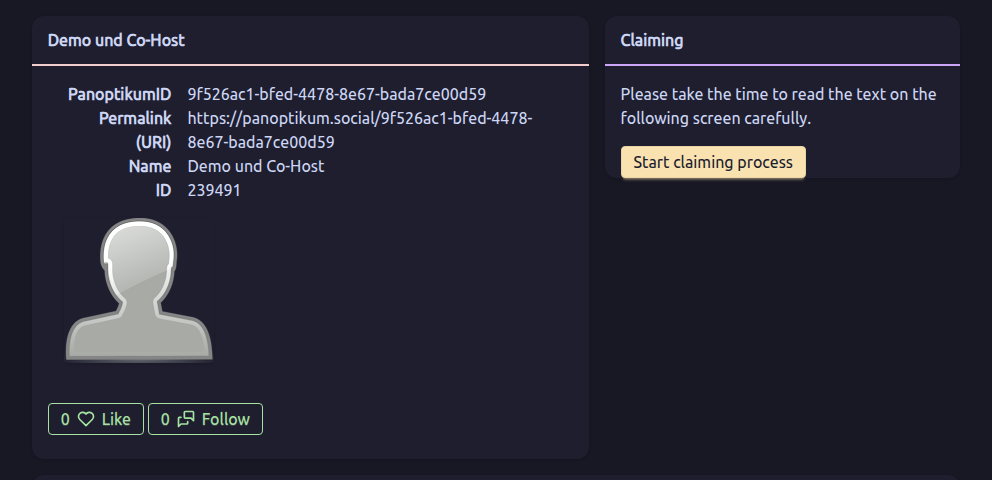
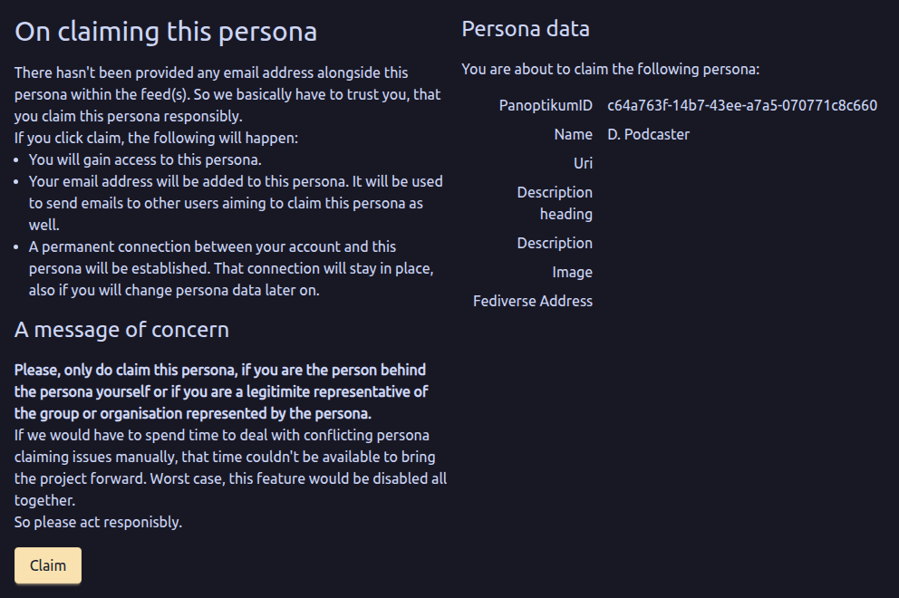

### Ihre Persona-Seite bearbeiten

Die automatisch erstellte Persona-Seite hat eine URL, die mit einer PID endet.

Ein beliebiges Beispiel:
[https://panoptikum.social/9e113027-16d7-5534-a6d5-1711c00e822c](https://panoptikum.social/9e113027-16d7-5534-a6d5-1711c00e822c).
Das kann man sich schwer merken.

Wenn Sie die Persona-Seite also als Schaufenster Ihrer Podcast-Projekte nutzen möchten, ändern Sie die URL in etwas Einprägsameres.

Ein weiteres Beispiel: [https://panoptikum.social/waldgruber](https://panoptikum.social/waldgruber).

Die Links zur Vorschau Ihrer Persona(s) finden Sie nach der Anmeldung unter „Mein Profil“.

**Bild**

Das Standardbild ist ein Platzhalter für Ihr eigenes Bild. Stellen Sie sich den Hörer:innen zusätzlich zu Ihrer Stimme aus den Podcasts auch mit einem Bild vor.

**Beschreibung**

Schreiben Sie auf Ihrer Persona-Seite über sich. Was sollen Interessierte über Sie wissen? Die Beschreibung (Description) ist eine kurze Zeile, die als Überschrift erscheint, die lange Beschreibung (Long description) der Text darunter.

Die lange Beschreibung kann Markdown enthalten – Sie können sich also kreativ beschreiben.

### Personas delegieren und weiterleiten

Weil Sie die Angaben auf der Persona-Seite bearbeiten können, kommen Sie über unvollständige Feed-Daten hinweg. Nicht alle Podcaster:innen nennen in jeder Episode alle Mitwirkenden, und wenn mehrere Leute einen Podcast gemeinsam besitzen, nennt der Feed sie zusammen.

* Delegierung: Mit einer Delegierung erscheinen die Gigs (also Beiträge zu Episoden) und Engagements (also Beiträge zu Podcasts) der Persona auch auf der Profilseite der Ziel-Persona.
* Weiterleitung: Die Weiterleitung leitet die Profilseite der Persona auf die Profilseite der Ziel-Persona weiter.

Mehr über Personas steht im Blog-Beitrag [User Self Service](/blog/2017-01-29-user-self-service) (auf Englisch).

### Nicht als Mitwirkende:r genannt?

Sie haben an Podcast-Episoden mitgewirkt, werden aber nicht als Mitwirkende:r genannt? Nicht alle Podcaster:innen sind Technik-Profis, und bei all den Details einer Episode im Podcast-Feed geht manchmal etwas schief. Zwischen Titel, Untertitel, Autor:in, Veröffentlichungsdatum, Beschreibung, Zusammenfassung und Shownotes wird ein Beitrag zu einer einzelnen Episode oft vergessen.

Panoptikum gibt diesen vergessenen Mitwirkenden einen Weg, ihre Mitwirkung an einer Episode einzutragen:
* Melden Sie sich an.
* Suchen Sie die Episode mit Ihrer (noch nicht angezeigten) Mitwirkung.
* Tragen Sie Ihre Mitwirkung auf der Detailseite der Episode mit einem Klick ein.

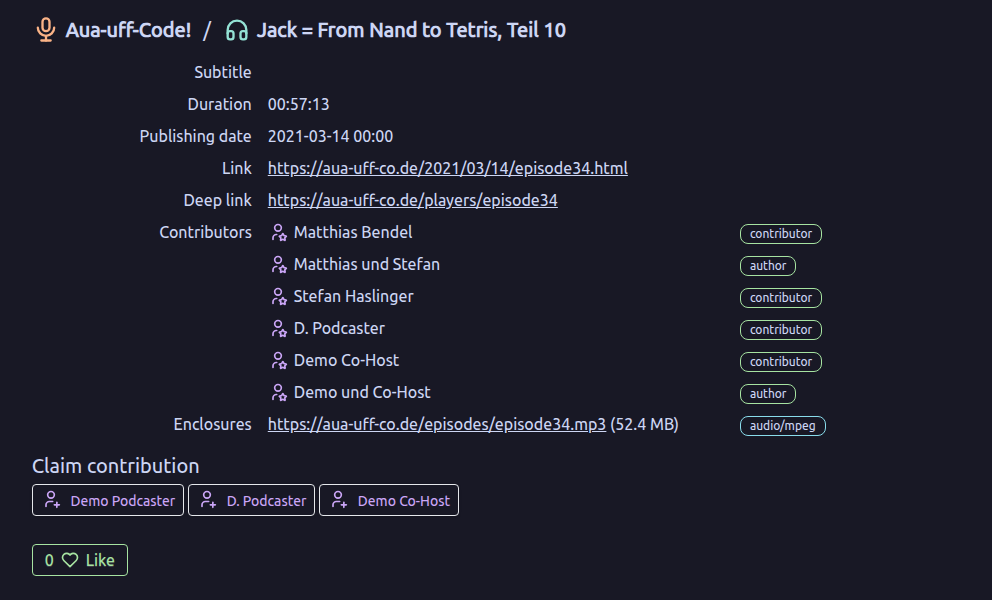

Damit stehen Sie in der Liste der Mitwirkenden.

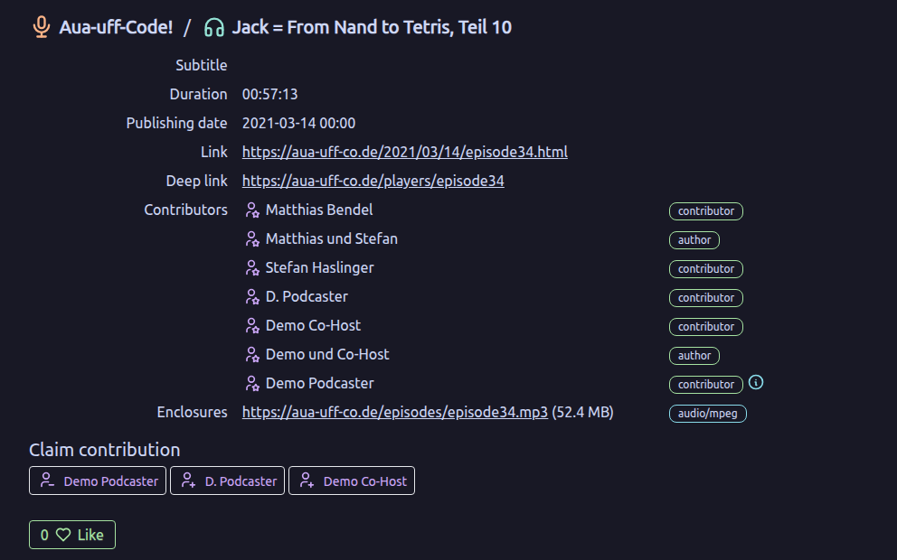

Beachten Sie das (i) nach Ihrem Namen. Es zeigt, dass die Mitwirkung von Hand von der Mitwirkenden eingetragen wurde und nicht aus dem Feed stammt. Wollen Sie Ihre Mitwirkung an dieser Episode wieder entfernen (vielleicht war es ein Irrtum), ziehen Sie sie mit einem weiteren Klick zurück: Nach dem Eintragen zeigt der Button eine Person mit einem Minus (siehe das Bild oben).

### Metadaten aktualisieren

Panoptikum hat einen eigenen Rhythmus, in dem es die Feeds der Podcasts aktualisiert. Nach einer neuen Episode prüft es innerhalb von 10 Stunden auf Aktualisierungen. Erscheint keine neue Episode, prüft es nach 11 Stunden, dann nach 12 usw. Das funktioniert für beide Seiten (Panoptikum und Podcaster:in) gut, solange die Podcaster:in eine Episode nicht kurz nachdem Panoptikum sie gelesen hat mit kleinen Änderungen (zum Beispiel einem korrigierten Tippfehler) neu veröffentlicht. Dann bliebe die veraltete Fassung der Episode stehen. Mit dem Button „Metadaten aktualisieren“ auf der Seite des Podcasts können Sie Panoptikum bitten, die Angaben aller Episoden dieses Podcasts sofort zu aktualisieren. So können Sie Fehler beim Veröffentlichen schnell ausbügeln. Nutzen Sie diesen Button, nachdem Sie eine Episode neu veröffentlicht haben!

* Melden Sie sich bei Panoptikum an.
* Gehen Sie auf die Seite Ihres Podcasts.
* Klicken Sie auf „Metadaten aktualisieren“.
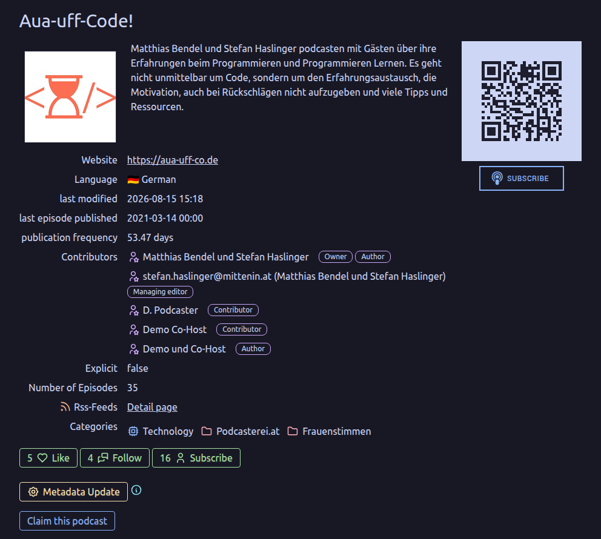

Der Button lässt sich einmal alle 5 Minuten pro Podcast nutzen. Dazwischen zeigt die Seite, in wie vielen Sekunden die nächste Aktualisierung möglich ist.

Mit „Metadaten aktualisieren“ können Sie auch den Zähler zurücksetzen, nach dem Panoptikum einen Podcast stilllegt. Angenommen, Sie waren (mit anderem) beschäftigt und veröffentlichen nach Monaten oder Jahren die nächste Episode – nutzen Sie dann „Metadaten aktualisieren“, damit Panoptikum merkt, dass Ihr Feed wieder aktiv ist.
 Konnte Ihr Feed erfolgreich gelesen werden, wird der Zähler auf null gesetzt, und der Podcast wird wieder regelmäßig geprüft.

### Ihr Podcaster:innen-Profil auf Panoptikum

Stefan hat auf der Subscribe 9 in München (Oktober 2017) einen Vortrag darüber gehalten, wie Sie Panoptikum für Ihr Podcaster:innen-Profil nutzen können. Der Titel war „Deine Visitenkarte ist zu klein!“. Sie finden ihn auf [YouTube](https://www.youtube.com/watch?v=btZcOEppi4E&index=2&list=PL0171AA0693FD18FC). Die Folien stehen auf der Seite [Vorträge](/talks).

### Schritt für Schritt: eine Persona übernehmen und bearbeiten

Gehen wir das Übernehmen und Bearbeiten einer Persona am Beispiel eines Demo-Accounts, „Demo Podcaster“, durch: Registrierung, Anmeldung und Übernahme einer Persona über **Mein Profil**.

Nach der Anmeldung können Sie Ihr Profil unter **Mein Profil** ansehen

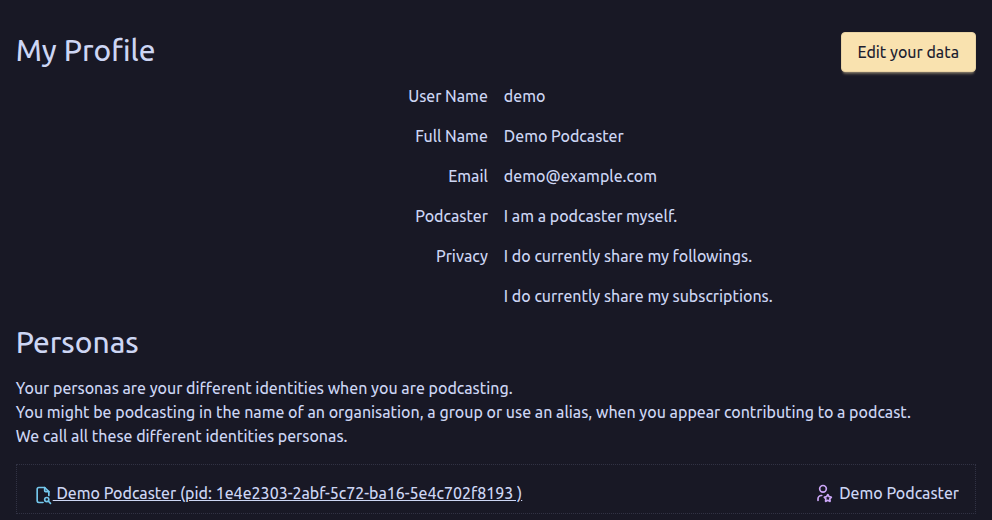

und mit **Ihre Daten bearbeiten** ändern.

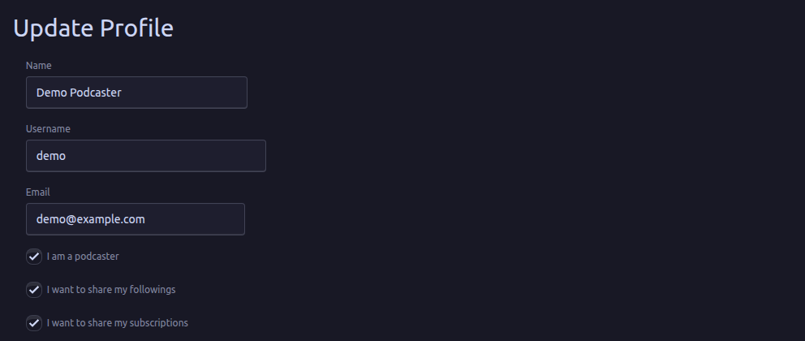

Weil ich „Ich bin Podcaster:in“ angekreuzt habe, hat Panoptikum bei meiner ersten Anmeldung eine Persona mit meinem vollen Namen, Demo Podcaster, angelegt. Es kann noch weitere Personas geben (aus den Angaben in Podcast-Feeds), die Sie als Manifestationen von sich erkennen, aber das weiß die Welt nicht. Sie müssen eine Manifestation in Panoptikum übernehmen, um diese Verbindung sichtbar zu machen.

Mein nächster Schritt ist also eine Suche nach Personas mit „Demo“ im Namen, und neben vielen anderen finde ich die Persona Demo Co-Host. Sie hat eine E-Mail-Adresse, also klicke ich im Bereich „Übernahme“ neben der Persona auf **Übernehmen**.

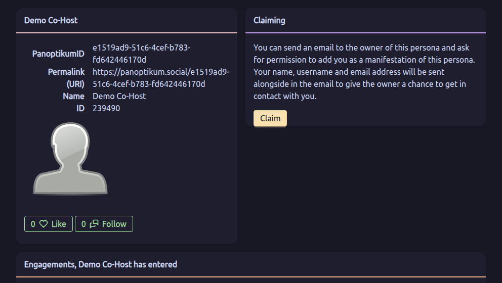

Damit wird eine E-Mail verschickt, und Panoptikum bestätigt, dass sie gesendet wurde.

Ist Ihre Adresse für diese Persona gespeichert (ebenfalls aus dem Podcast-Feed), bekommen Sie eine E-Mail mit dem Betreff „Panoptikum - Anfrage zur Übernahme einer Persona“ (oder auf Englisch „Persona manifestation confirmation request“, je nach Sprache der Podcasts der Persona). Finden Sie die E-Mail nicht im Posteingang, schauen Sie im Spam-Ordner nach. Für Demo Co-Host geht die E-Mail an demo-cohost@example.com, eine weitere Adresse von mir.

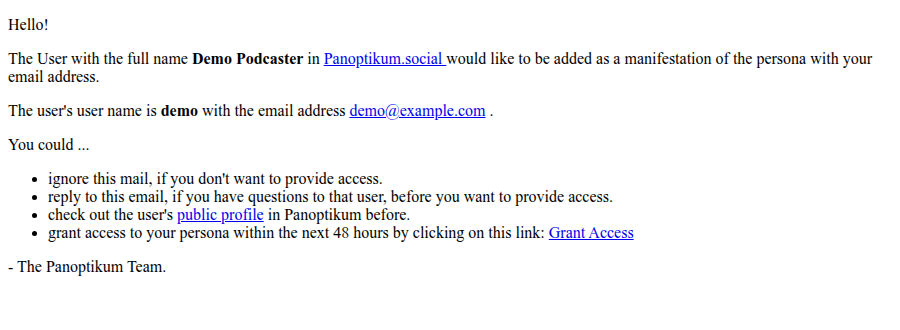

Nachdem Sie den Link **Zugriff gewähren** in der E-Mail genutzt haben, hat sich Ihr Profil verändert. Die übernommene Persona wird angezeigt. Ich habe auch D. Podcaster übernommen, eine Persona ohne E-Mail-Adresse (siehe „Personas übernehmen“ oben), daher listet „Mein Profil“ jetzt drei Personas.
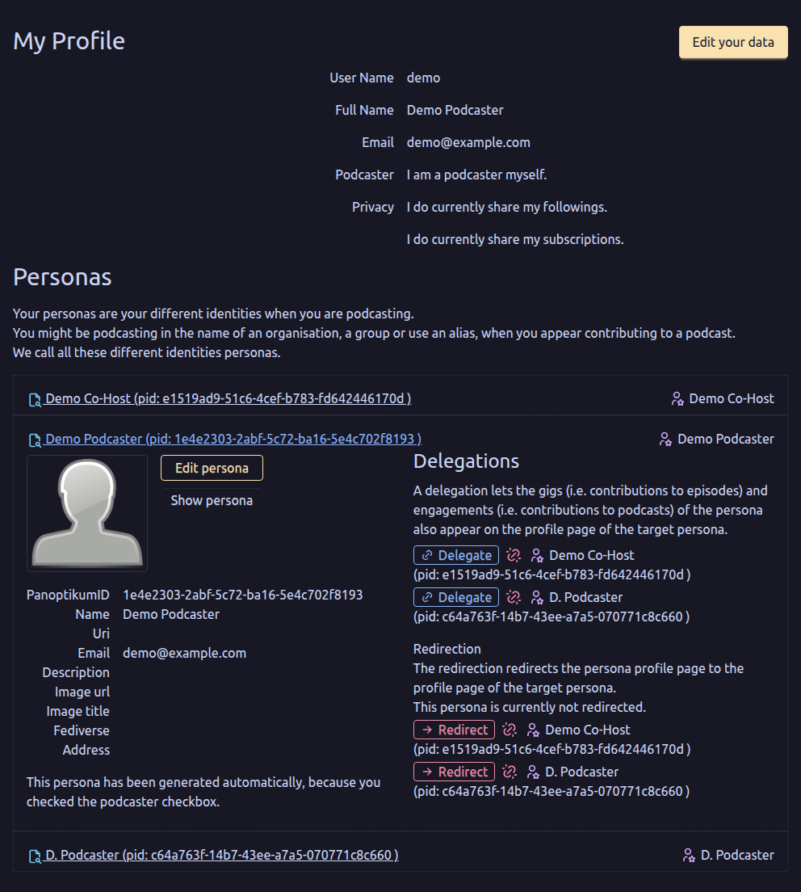

Mit **Persona bearbeiten** lassen sich die Angaben ändern.
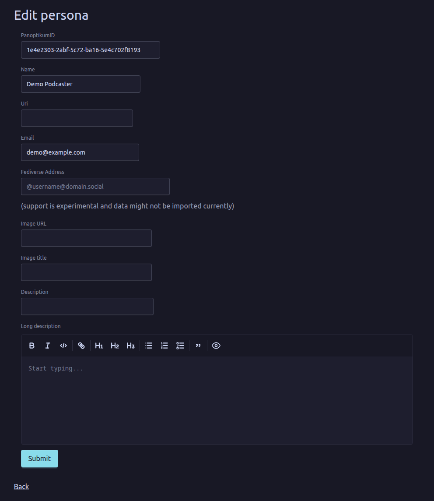

Änderungen
* Panoptikum-ID: vom Standardwert auf demo-podcaster – die neue URL der Persona ist also panoptikum.social/demo-podcaster
* Bild-URL: der Link zu einem Bild im Internet (am besten eines, über das Sie die volle Kontrolle haben, zum Beispiel auf Ihrer eigenen Website, Sie können aber jedes im Internet veröffentlichte Bild verwenden)
* Bildtitel: der Alternativtext für das Bild
* Beschreibung: eine kurze Zeile, die als Überschrift des Textes über Sie erscheint
* Lange Beschreibung: der Text über Sie, mit Markdown (hier leer gelassen)

URI (ein Link zu Ihrer eigenen Website, auf der Persona-Seite angezeigt) und Fediverse-Adresse (experimentell, noch nicht angezeigt) bleiben, wie sie sind.

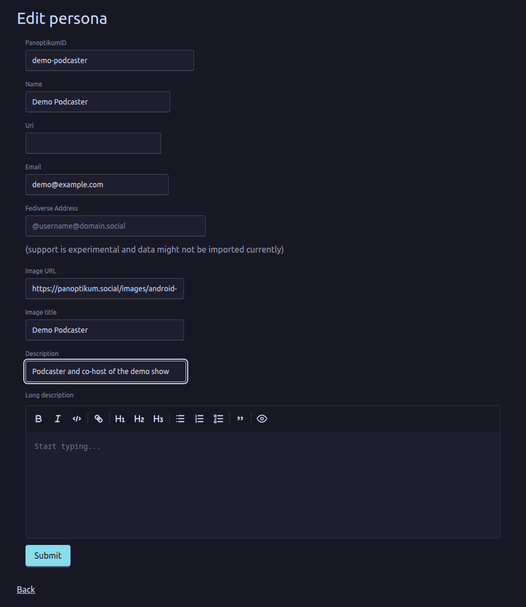

Nach einem Klick auf **Absenden** ist die Persona unter https://panoptikum.social/demo-podcaster erreichbar und sieht so aus: 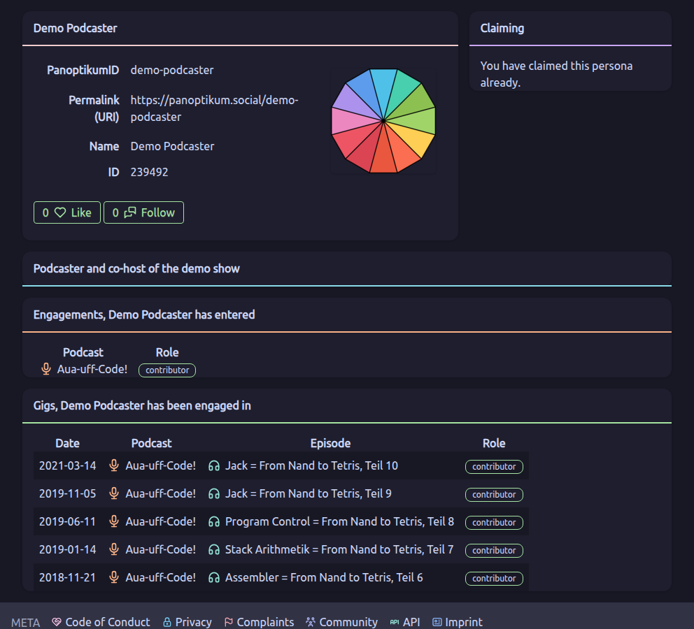

Das ist jetzt eine Seite, die ich als Anlaufstelle für alle meine Podcast-Aktivitäten nutzen kann.

Finde ich weitere Personas, die ich übernehmen möchte, gehe ich genauso vor. Ich übernehme die Persona, und wenn ich die Gigs (aus Episoden) und Engagements (aus Podcasts) dieser weiteren Personas unter einer „Haupt“-Persona zeigen möchte, delegiere ich sie an die Persona, die ich zur Haupt-Persona bestimmt habe.

In meinem Fall habe ich 3 Personas. Ich bestimme „demo-podcaster“ zur Haupt-Persona und delegiere die beiden anderen, D. Podcaster und Demo Co-Host, an sie: Unter „Mein Profil“ öffne ich jede davon und klicke neben Demo Podcaster auf **Delegieren**.

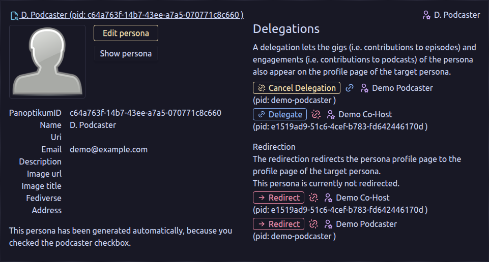

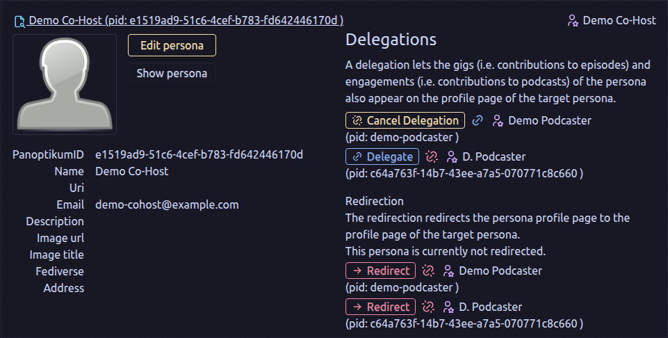

Die Haupt-Persona hat selbst keine Delegierung.

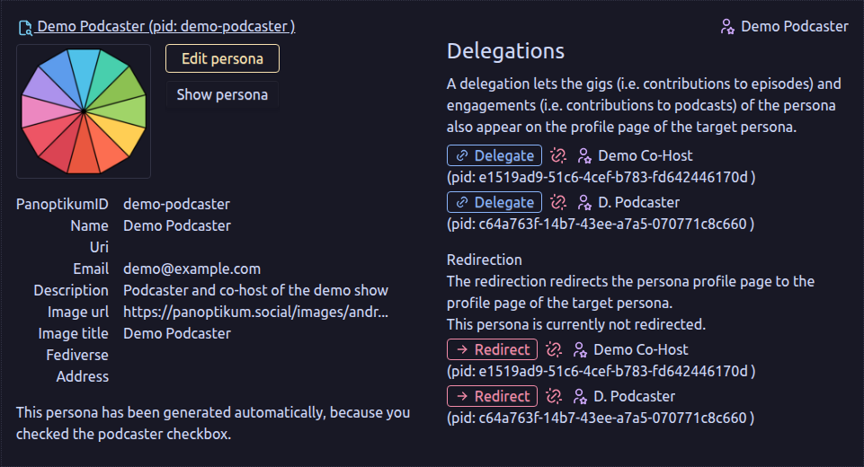

Personas, die nur delegiert und nicht als Anlaufstelle genutzt werden, werden nicht weiter verschönert. Um sie auszublenden, könnte ich sie auf die Haupt-Persona weiterleiten.

[Melden Sie sich an](https://panoptikum.social/sessions/new) und legen Sie los – keine Testphase, keine Zahlung, einfach anmelden.

## Allgemeine Tipps

### Verbessern Sie die Metadaten Ihres Podcasts

Panoptikum und andere Podcast-Plattformen sind auf korrekte Metadaten Ihres Podcasts angewiesen. Metadaten sind die Felder in Ihrem RSS-Feed, die zusätzliche Informationen über Ihren Podcast und seine Episoden liefern.

* Wählen Sie die passenden Kategorien, um Ihren Podcast in einem oder mehreren Zweigen des Kategorienbaums von Panoptikum zu listen.
* Nennen Sie alle Mitwirkenden in Ihrem Feed. Aus den Mitwirkenden in Ihrem Feed legt Panoptikum automatisch die Personas an und ordnet die Gigs bestehenden Personas zu. Panoptikum liest das Tag `podcast:person` aus dem [Podcasting-2.0-Namespace](https://podcasting2.org/docs/podcast-namespace/tags/person), für den Podcast und für einzelne Episoden, mit der Rolle jeder Person.

In der Dokumentation Ihrer Podcast-Software steht, wie Sie die Metadaten am besten setzen. „Feed prüfen“ zeigt Ihnen, was Panoptikum aus Ihrem Feed liest (siehe „Ihren Feed prüfen“ oben).

### Das Tag new-feed-url beim Umzug

Mit dem Tag new-feed-url können Sie die Adresse (URL) Ihres RSS-Feeds ändern, wenn Ihr alter Hoster keine Weiterleitung anbietet. Setzen Sie das Tag mit der neuen URL einfach in Ihren ALTEN RSS-Feed.
