+++
title = "Podcaster Manual"
description = "How to use Panoptikum as a podcaster: listing, personas, API and more."
menu = "main"
weight = 20
redirect_from = ["/podcaster-manual"]
+++

(There are also a [Listener Manual](/manuals/listener-manual), a [Moderator Manual](/manuals/moderator-manual) and a [Curator Manual](/manuals/curator-manual), see the [overview of all manuals](/manuals).)

This [Podcaster Manual](/manuals/podcaster-manual) describes the use of Panoptikum from the podcaster perspective. Please read the [Listener Manual](/manuals/listener-manual) before this one. Panoptikum uses metadata in the RSS feeds to identify contributors and presents information regarding those persons. Podcasters can enhance and manage their automatically generated business cards for free.

## Functionality Independent from Registration

Basic functionality for podcasters:

* Listing of the podcast at Panoptikum in the categories assigned in the feed
* Episode list with shownotes and integrated player on episode detail page
* Easy subscription to the podcast with subscribe button or QR-code
* Recommendations
* API to retrieve data
* Personas

Panoptikum shows statistics regarding podcasts directly on the page. The API offers the possibility for podcasters to retrieve data for their own application or web site. No information regarding single listeners (besides you) is offered via the API.

### Listing of My Podcast

Your podcast gets listed on Panoptikum, if it is included in at least one uploaded OPML-file of a registered user. You can also add your podcast personally after registration. Registered users can use the "suggest a podcast" function offered in the sub menu below your user name. Please see the [Listener Manual](/manuals/listener-manual) for more information regarding registration and listing of podcasts.

If you want to remove your podcast from Panoptikum, please send an email to <sonja@panoptikum.social>. There is no need to give a reason. This is a manual procedure.

Panoptikum stops to check for updates of a Podcast after 10 failed attempts. You can reset the counter (after login) by a successfull "Metadata Update" (more details at the section "Metadata Update").

### Better Discovery for and Easy Subscription to Your Podcast

The listing on Panoptikum gives your podcast the chance to get discovered by listeners. It can be found based on recommendations, categories and the search function. With the episode list including shownotes interested listeners get a good overview of your podcast and its content. The integrated player offers the fastest way to listen into the podcast and to get a feeling, if the interested listener and you are tuned on the same wavelength.

The interested listener can become your regular listener by using the subscribe button or the QR-code on the page of your podcast on Panoptikum easily.

Copy the QR-code for the subscription of YOUR podcast! The QR-code on the page of your podcast at Panoptikum does not only make it easier for interested people to subscribe your podcast. You can also use it! Just copy the QR-image to your own site, stickers, business cards. What ever you use to spread the news about your podcast, the subscription to your podcast is just a scan away.

### Recommendations

For those of your listeners, who would like to post a recommendation for your podcast, but are fans of their privacy and would rather not use the big platforms for it, Panoptikum offers the recommendation function.

Panoptikum is a project, that respects the privacy of its users. Please check out our [Privacy Policy](/privacy) for more details.

### API

Panoptikum offers an API for other appilications. This gives you the possibility to retrieve data for your own project or homepage. The API adheres to [json:api](https://jsonapi.org/) standards. Podcasts within a category, gigs by a persona and episodes for a podcast are paginated.

The endpoints are available without throttling, with one exception: the update of a podcast (`trigger_update` and `trigger_episode_update`) can be asked for once every 5 minutes per podcast. An earlier request gets the status 429 ("Too many requests") with the number of seconds until the next update is possible.

Using full text search your program can search in categories, podcasts, episodes and personas.

Examples
* [https://panoptikum.social/jsonapi/search?filter[persona]=Sonja](https://panoptikum.social/jsonapi/search?filter[persona]=Sonja) to search for all personas with the name Sonja
* [https://panoptikum.social/jsonapi/search?filter[episode]=coding](https://panoptikum.social/jsonapi/search?filter[episode]=coding) to find episodes including the term coding in title, description, show notes, etc.
* [https://panoptikum.social/jsonapi/podcasts/most_liked](https://panoptikum.social/jsonapi/podcasts/most_liked)
  for the top 10 liked podcasts ordered by like count descending.  
* [https://panoptikum.social/jsonapi/podcasts/most_subscribed](https://panoptikum.social/jsonapi/podcasts/most_subscribed)
  for the top 10 subscribed podcasts ordered by subscription count descending.
* [https://panoptikum.social/jsonapi/podcasts/last_updated](https://panoptikum.social/jsonapi/podcasts/last_updated)
  for the last updated podcasts (paginated - you define the amount, default is 10).

Please check out the [API documentation](/api) for details.

### Personas

Within the Panoptikum universe each person can have different roles. There is the registered user, this user can login with username and password. Then there is the podcaster, this is a person that produces podcasts. One becomes a podcaster by owning a podcast or contributing to a podcast. But what about companies with podcasts or several people that produce a podcast together? This leads to personas.

Based on the contributors of podcasts personas are automatically created. These are listed under the menu item [Podcasters](https://panoptikum.social/personas).
Use the search on the [personas page](https://panoptikum.social/personas) to find your persona(s). The search results are updated with each key stroke while you enter the search string. Often you don't need to enter a complete search term to find your persona.

Two examples:
* Mathilda is a podcast listener. She is no podcaster and has no persona.
* Stefan is a listener and a podcaster. He produces a podcast together with Matthias
[Aua-uff-code!](https://panoptikum.social/podcasts/104), contributed for example to
[Zeitsprung #64](https://panoptikum.social/episodes/40276), visited the
[IT-Keller](https://panoptikum.social/podcasts/495), talked regulary at the
[Biertaucher](https://panoptikum.social/podcasts/119) and so on. He clearly is a podcaster
(derived from the owner information of the feed of
[Aua-uff-code!](https://panoptikum.social/podcasts/104)) and he has a persona Informatom, where he can present all his achievements.

## Functionality for Registered Podcasters

During registration and later in your profile you can select, if you are podcaster or not (checkbox Podcaster).

Benefits for registered podcasters:

* Suggest your own podcast
* Write recommendations
* Claim your podcast and check its feed
* Claim personas
* Edit your persona page (URL, image, description)
* Redirect and delegate personas

Based on the contributors of podcasts personas are automatically created. These are listed under [Podcasters](https://panoptikum.social/personas) on the Panoptikum page.

### Claim Your Podcast

A podcast on Panoptikum can be managed by one registered user. As the one who manages your podcast you can check its feed (see "Check Your Feed" below). Your podcasts are listed under **Podcasts I manage** on **My Podcasts**. Claiming needs a verified email address.

There are two ways to get there:

* Automatically: when you open **My Podcasts**, Panoptikum assigns you all podcasts that nobody manages yet and whose feed lists your email address as the owner's address (for example in `itunes:owner`).
* With **Claim this podcast** on the page of your podcast, if nobody manages it yet: Panoptikum sends a confirmation link to the owner address listed in the feed. Whoever reads the mails of that address opens the link and confirms; then you manage the podcast. The link is valid for 48 hours.

If the feed lists no owner address, Panoptikum can't send the confirmation. If someone else manages your podcast by mistake, please write to <sonja@panoptikum.social>.

### Check Your Feed

**Check feed** on the page of your podcast shows a report on your feed. It is there for the one who manages the podcast, for the moderators and for the Panoptikum team. Panoptikum downloads a fresh copy of the feed for every check, so you can fix your feed and use **Check again** to see the result.

The report checks the feed against the rule sets of RSS 2.0, Apple Podcasts and Podcasting 2.0, each with errors, warnings and hints, a link to the rule and where the problem is in your feed. The boxes at the top switch the rule sets on and off. Further sections show what Panoptikum reads from your feed anyway, although it isn't standard (other apps may not), and what Panoptikum reads from your feed at all: title, artwork, owner, categories, persons, episodes and more.

Two buttons check more than the feed itself:

* **Probe artwork and episodes** downloads the artwork and asks for the audio files of the newest 10 episodes, for example whether the artwork has the right size and whether the audio files can be reached.
* **Probe audio** reads the first megabyte of the newest 3 episodes and checks format, sample rate, bit rate and loudness against Apple's audio requirements.

### Claim Personas

The usual claiming process is based on the email address of the persona.

* Persona with email address: You can send an email to the owner of this persona and ask for permission to add you as a manifestation of this persona. Your name, username and email address will be sent alongside in the email to give the owner a chance to get in contact with you.

* Persona without email address: A warning is shown, if you use the "Start claiming process" button. If you continue you will gain access to this persona and your email address will be added to this persona. It will be used to send emails to other users aiming to claim this persona as well. A permanent connection between your account and this
persona will be established. This solution is based on trust - we trust you, that you will use it responsibly and not claim personas, that should not be connected to you. In the unlikely case of severe misuse we will have to remove this feature again.
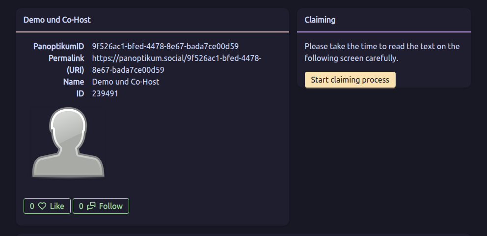
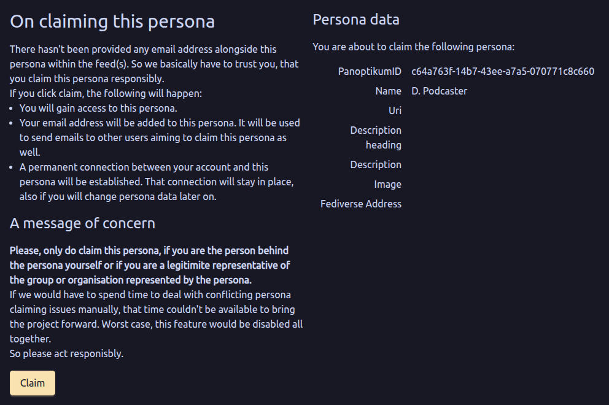

### Editing Your Persona Page

The automatically generated persona page has an URL that ends with a PID.

A random example
[https://panoptikum.social/9e113027-16d7-5534-a6d5-1711c00e822c](https://panoptikum.social/9e113027-16d7-5534-a6d5-1711c00e822c).
This is this rather difficult to remember.

So if you want to use the persona page as a showcase of your podcaster portfolio change the URL to something more memorable.

Another random example [https://panoptikum.social/waldgruber](https://panoptikum.social/waldgruber).

You can find the link(s) to the preview page of your persona(s) after login under myProfile.

**Image**

The default image acts as a placeholder for your personal image. Introduce yourself to listeners with additional visual information, beside your voice from the podcast(s).

**Description**

Write about yourself on your persona page. What should interested listeners know about you? The Description is a short line, shown as the heading, the Long description the text below it.

The Long description supports markdown - so you are free to use your creativity describing yourself.

### Delegating and Redirecting Personas

The possibilty to edit the presented information on the persona page helps to overcome the hurl of incomplete feed data. Not all podcast producers name all contributors in each episode or if several people own a podcast together, the feed lists them together.

* Delegation: A delegation lets the gigs (i.e. contributions to episodes) and engagements (i.e. contributions to podcasts) of the persona also appear on the profile page of the target persona.
* Redirection: The redirection redirects the persona profile page to the profile page of the target persona.

For more details information regarding personas please check out the blog post [User Self Service](/blog/2017-01-29-user-self-service).

### Not Listed as Contributor?

Have you contributed to podcast episodes, but you are not listed as a contributor? Not all podcasters are technical experts and sometimes things go wrong with all the details of a podcast episode in a podcast feed. Between episode title, subtitle, author, puplishing date, description, summary and show notes a contribution to a single episode is often forgotten.

Panoptikum gives these forgotten contributors a way to claim their contribution to an episode:
* Login
* Find the episode with your (not yet shown) contribution.
* Add your personal contribution on any episode detail page by a single click

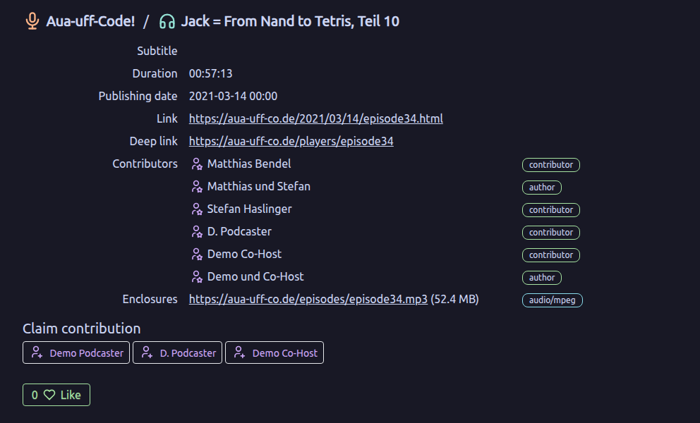

This adds you to the list of contributors

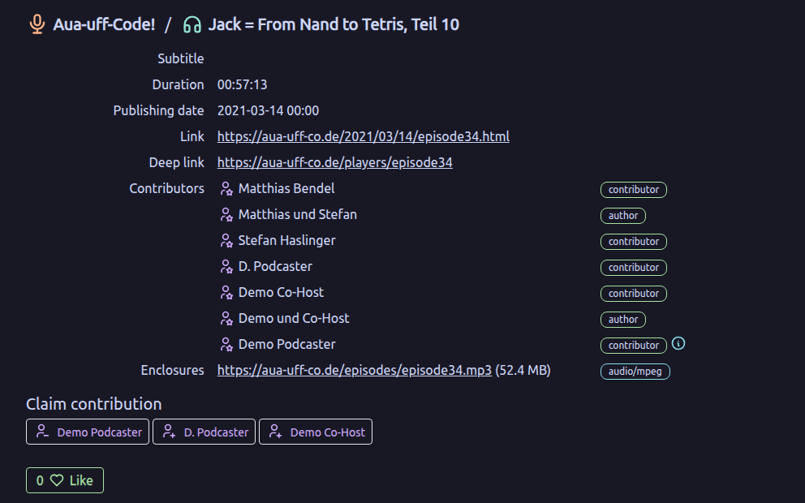

Please note the (i) after your name. This informs the viewer that the contribution was added manuelly by the contributor and was not derived from the feed. If you want to remove your contribution to this episode (maybe you made a mistake) just withdraw it by clicking once more: after the claim the button shows a person with a minus (see the picture above).

### Metadata Update

Panoptikum has its own update cycle regarding the podcasts feeds. It checks for updates within 10 hours after a new episode has been found. If no new episode has been published, then we check after 11 hours, then after 12, etc. This works well for both sides (Panoptikum and podcaster) as long as the podcaster does not republish an episode with small changes (to fix a typo, for instance) shortly after Panoptikum has already read the new episode. In this case the information of the outdated episode would linger around. With the button "Metadata Update" on the podcast page you can now ask Panoptikum to update the information of all episodes of this particular podcast immediately. This gives you the chance to hide mistakes in your publishing process. Use this button after you have republished an episode!

* Login to Panoptikum
* Go to the page of your podcast
* Use the "Metadata Update" button
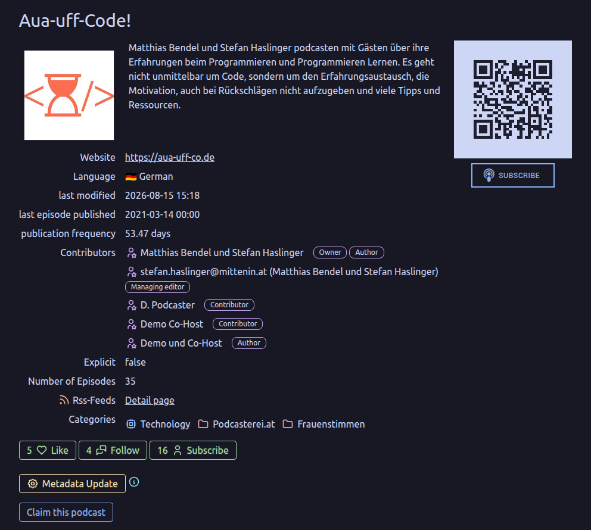

The button can be used once every 5 minutes per podcast. In between, the page tells you in how many seconds the next update is possible.

With "Metadata Update" you can also reset the counter in Panoptikum, that sets a podcast in the status retired. Let's say you were busy (with other stuff) and after several months / years you publish the next episode - use the "Metadata Update" button to give Panoptikum the chance to find out that your feed is active again.
 If your feed could be read successfully, the counter is reset to zero and the podcast will be rechecked regularly.

### Your Podcaster Profile in Panoptikum

Stefan held a talk at Subscribe 9 in Munich (October 2017) about the possibilites of using Panoptikum for your podcaster profile. The title of the talk was "Deine Visitenkarte ist zu klein!" (Your Business Card is too small). You can find it at [youTube](https://www.youtube.com/watch?v=btZcOEppi4E&index=2&list=PL0171AA0693FD18FC). The slides are listed on the [Talks](/talks) page.

### Walkthrough: Claiming and Editing a Persona

Let's walk through claiming and editing a persona with a demo user, "Demo Podcaster", as an example: registration, log in and claim a persona from **My Profile**.

After the login you can check your profile under **My Profile**

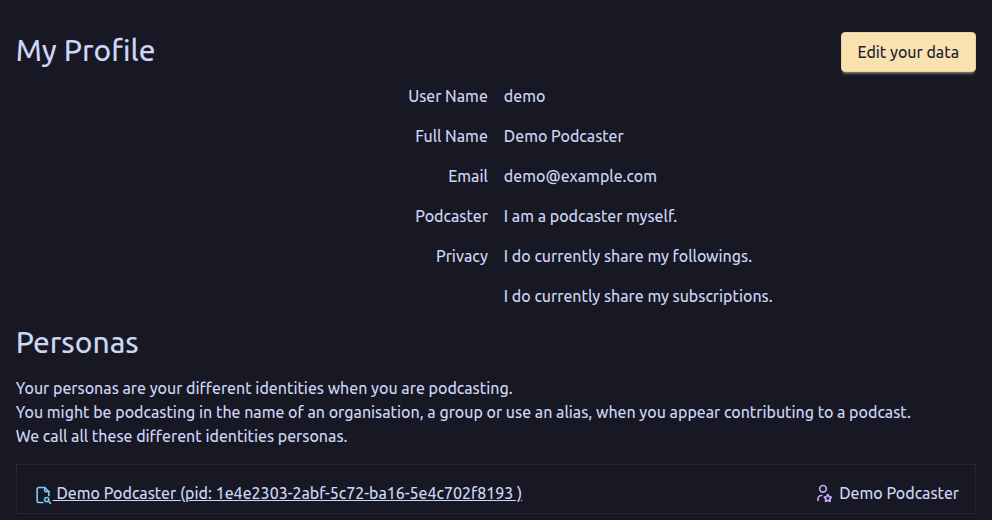

and change it with **Edit your data**

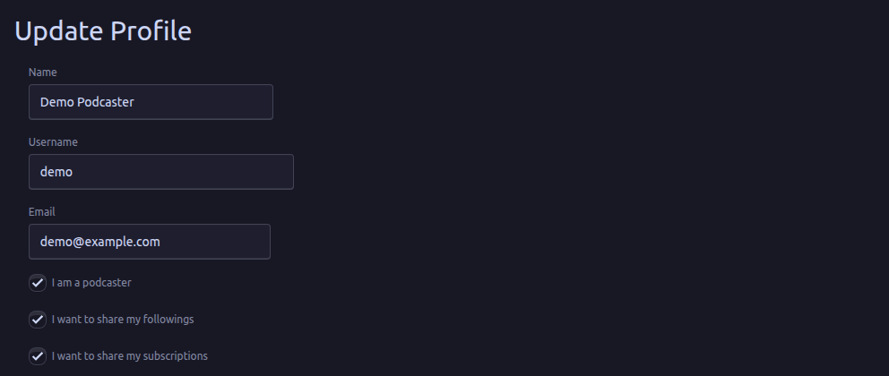

Because I checked "I am a podcaster myself", Panoptikum created a persona with my full name, Demo Podcaster, at my first login. Several more personas can exist (based on the information in podcast feeds) that you recognise as manifestations of you, but this is not known to the world. You have to claim a manifestation within Panoptikum to make this connection visible.

So my next step is a search for personas with "Demo" in the name and beside many others I find the persona Demo Co-Host. It has an email address, so I use the button **Claim** in the Claiming panel next to the persona.

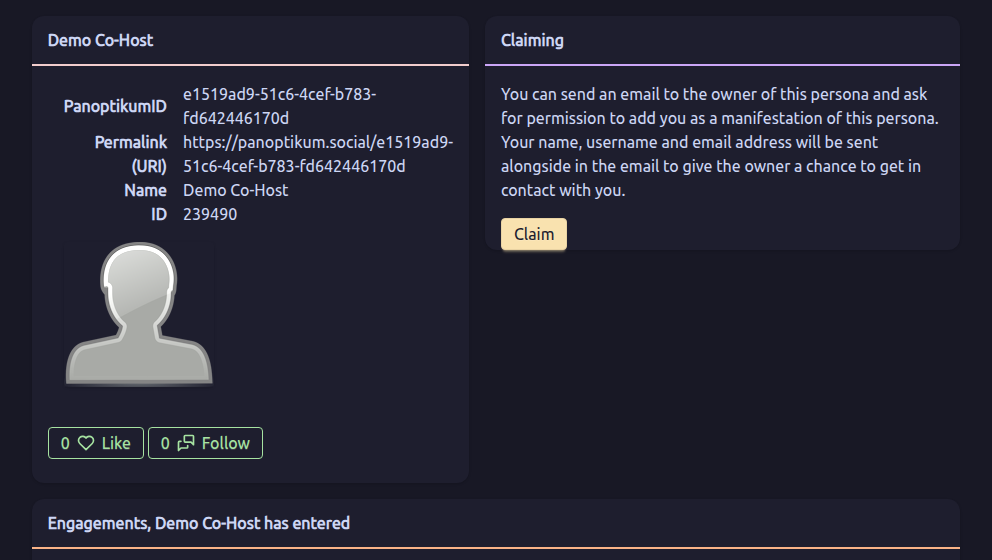

This initiates an email, and Panoptikum confirms that it has been sent.

If your address is stored for this persona (also derived from the podcast feed), you receive an email with the subject "Panoptikum - Persona manifestation confirmation request". If you don't find the email in your inbox check out the spam folder. For Demo Co-Host the email goes to demo-cohost@example.com, another address of mine.

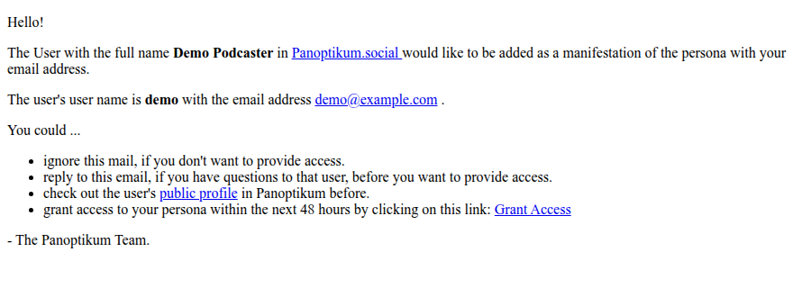

After you have used the **Grant Access** link in the email your profile has changed. The claimed persona is shown. I have also claimed D. Podcaster, a persona without email address (see "Claim Personas" above), so My Profile lists three personas now.
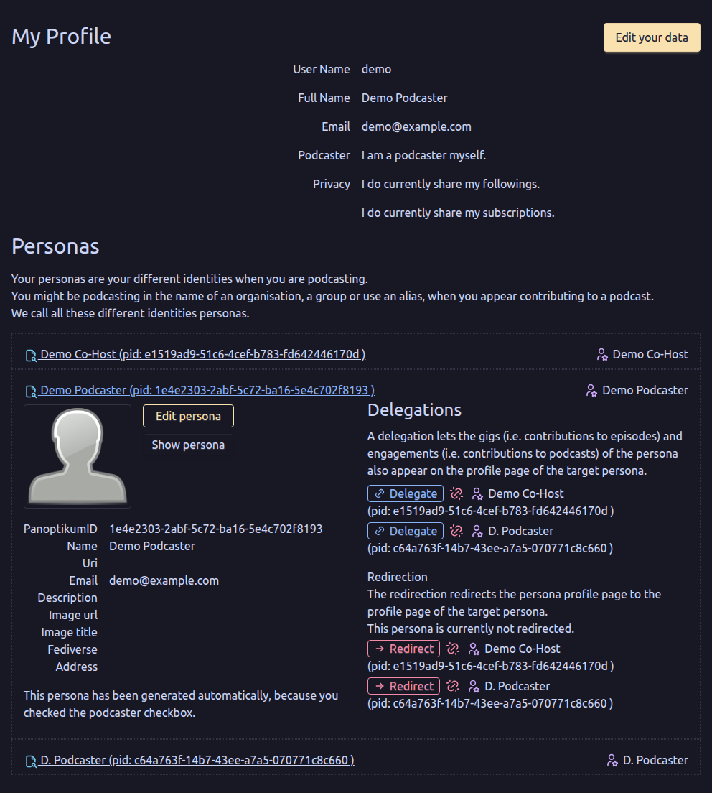

With **Edit persona** the information can be changed
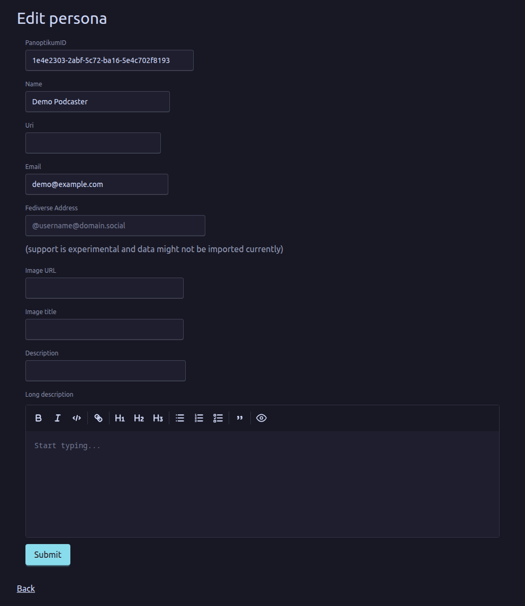

Changes
* PanoptikumID: from the default value to demo-podcaster - so the new URL to the persona is panoptikum.social/demo-podcaster
* Image URL: the link to a picture on the internet (best one you have in full control, for example on your personal homepage, but you can use any picture published on the internet)
* Image title: This is the alternative text for the picture.
* Description: a short line, shown as the heading of the text about you
* Long description: the text about you, with markdown (left empty here)

Uri (a link to your own website, shown on the persona page) and Fediverse Address (experimental, not shown yet) stay as they are.

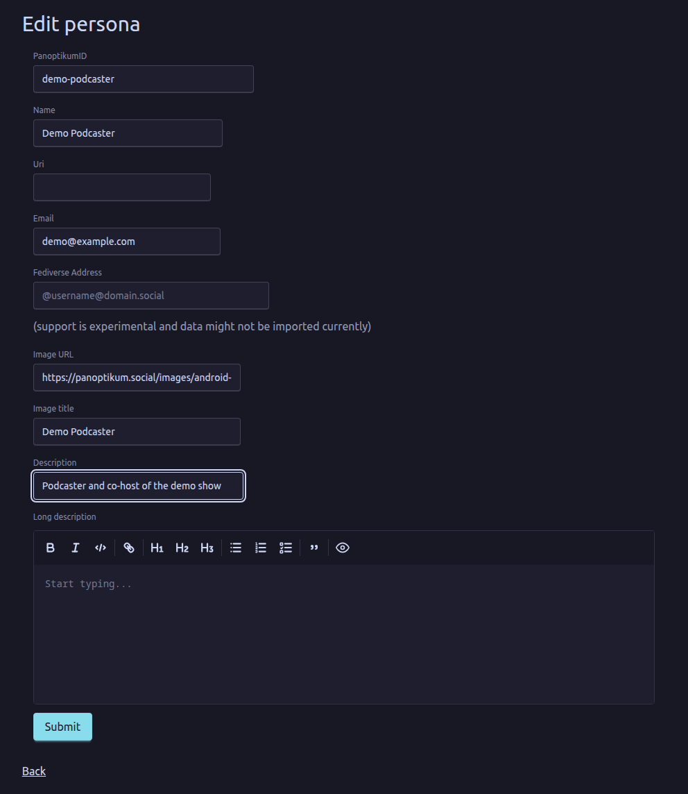

After clicking **Submit** the persona can be reached via https://panoptikum.social/demo-podcaster and looks like this 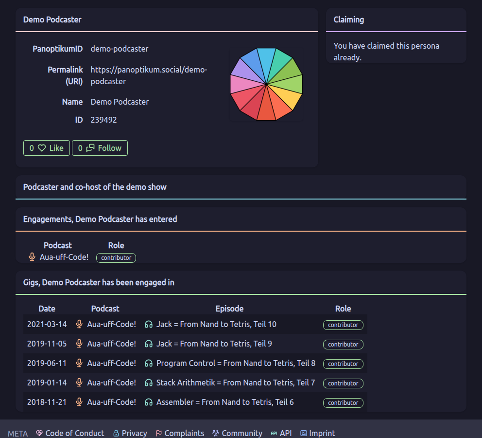

This is now a page, that I can use as the reference to all my podcast related activities.

If I find other personas, whom I wish to claim, I follow the same steps. I claim the persona and if I want to show the gigs (from episodes) and the engagements (from podcasts) of those further personas under one "main" persona I delegate them to the persona, I decided to be the main one.

In my case I have 3 personas. I decide that "demo-podcaster" is my main persona and delegate the 2 other personas, D. Podcaster and Demo Co-Host, to it: on My Profile I open each of them and use **Delegate** next to Demo Podcaster.

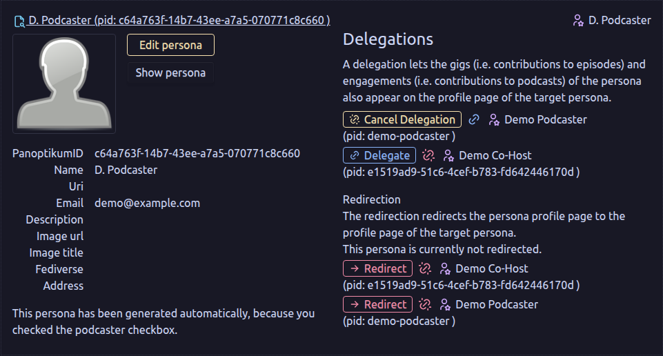

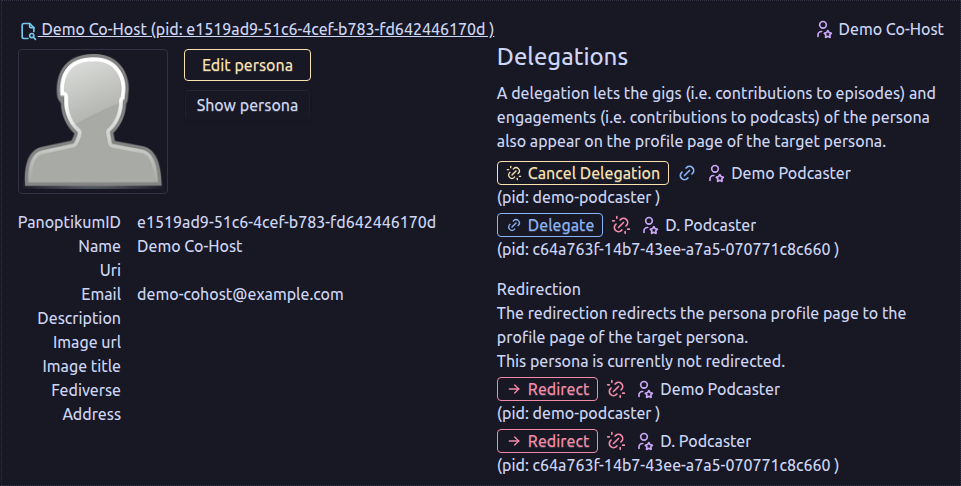

The main persona has no delegation what so ever.

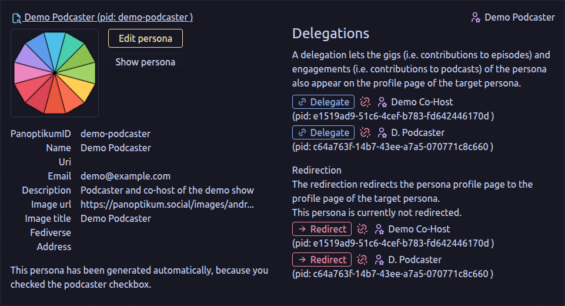

Personas, that are only delegated and not used as a reference page, are not edited to look nicer. To hide them, I could redirect them to the main persona.

[Login](https://panoptikum.social/sessions/new) to get started - no trial, no payment, just log in.

## General Tips

### Improve Your Podcast Metadata

Panoptikum and other podcast platforms rely on correct metadata of your podcast. Metadata are those fields in your RSS feed, that provide additional information regarding your podcast and its episodes.

* Use the matching categories to list your podcast in one or more branches of the Panoptikum category tree.
* Add the names of all contributors to your feed. Based on the contributors in your feed Panoptikum automatically generates the personas and adds the gigs to an existing persona. Panoptikum reads the `podcast:person` tag of the [Podcasting 2.0 namespace](https://podcasting2.org/docs/podcast-namespace/tags/person), for the podcast and for single episodes, with the role of each person.

Check out the documentation of your podcast publishing software to set the metadata in the best way possible. "Check feed" shows you what Panoptikum reads from your feed (see "Check Your Feed" above).

### Tag new-feed-url in case of relocation

The new-feed-url tag helps you change your podcast RSS feed address (URL), if your old hoster does not support a redirect. Just put the tag with the new url in your OLD RSS feed.
